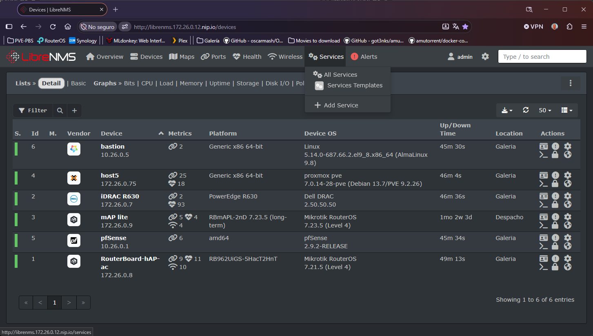
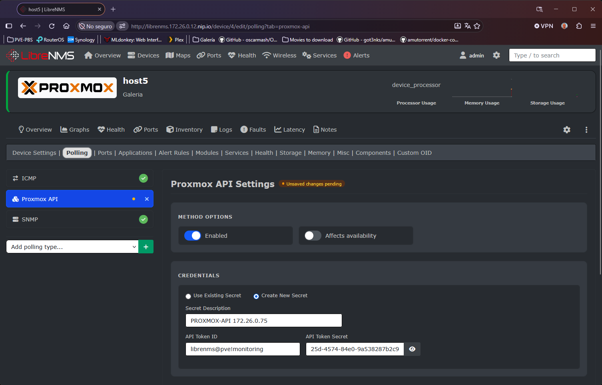
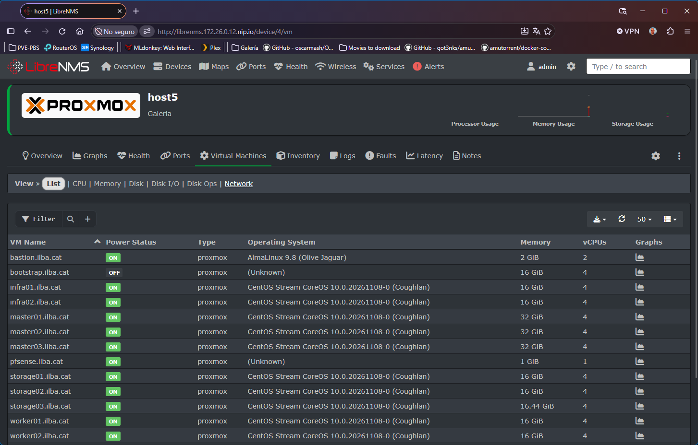

## Índice

- [LibreNMS](#librenms)
  - [Instalación](#instalación)
  - [Validaciones](#validaciones)
- [Añadir equipos](#añadir-equipos)
  - [Host](#host)
  - [VMs de Proxmox](#vms-de-proxmox)

# LibreNMS

## Instalación

```
[root@bastion ~]# helm repo add librenms https://www.librenms.org/helm-charts
[root@bastion ~]# helm repo update
[root@bastion ~]# oc new-project ilba-librenms --description="LibreNMS is an autodiscovering network monitoring system" --display-name="LibreNMS"
```

Para evitar que la API de Kubernetes/OKD lance advertencias al aplicar manifiestos en este namespace, relaja el nivel de auditoría de Pod Security en el proyecto:
* warn=privileged: ontrola cuándo la API de Kubernetes/OKD muestra advertencias visuales (warnings) en la consola al aplicar manifiestos.
* audit=privileged: evita que el clúster llene los registros de auditoría, ya que le hemos dicho: "warn=privileged".

```
oc label namespace ilba-librenms \
  pod-security.kubernetes.io/warn=privileged \
  pod-security.kubernetes.io/audit=privileged \
  --overwrite
```

En OKD / OpenShift, la seguridad de ejecución de los contenedores está gobernada por los Security Context Constraints (SCC). A diferencia de Kubernetes estándar, OKD no permite por defecto que los contenedores se ejecuten como usuarios fijos de Linux (root o UIDs del sistema).
* anyuid: es para que el pod de la base de datos (MySQL / MariaDB) pudiera crearse y arrancar
* privileged: es para resolver el envío de paquetes ICMP (ping) en los pods de LibreNMS

```
oc adm policy add-scc-to-user anyuid -z default -n ilba-librenms
oc adm policy add-scc-to-user privileged -z default -n ilba-librenms
```

```
[root@bastion 51-ilba-librenms]# vim values-librenms.yaml
librenms:
  privileged: true
ingress:
  enabled: true
  className: openshift-default
  hosts:
    - host: librenms.172.26.0.12.nip.io
      paths:
        - path: /
          pathType: ImplementationSpecific
  tls: []
```

```
[root@bastion 51-ilba-librenms]# helm search repo librenms/librenms
NAME                    CHART VERSION   APP VERSION     DESCRIPTION
librenms/librenms       10.5.0          26.11.0         LibreNMS is an autodiscovering PHP/MySQL-based ...
```

```
helm upgrade --install \
librenms librenms/librenms \
--namespace ilba-librenms \
--version=10.5.0 \
-f values-librenms.yaml
```

```
[root@bastion ~]# oc get pods -n ilba-librenms
NAME                                  READY   STATUS    RESTARTS   AGE
librenms-frontend-6c77665856-frsbr    1/1     Running   0          16m
librenms-mysql-0                      1/1     Running   0          16m
librenms-poller-0                     1/1     Running   0          16m
librenms-redis-0                      1/1     Running   0          16m
librenms-rrdcached-6f48c6b95f-fzgkk   1/1     Running   0          16m

[root@bastion ~]# oc -n ilba-librenms get ingress
NAME       CLASS               HOSTS                         ADDRESS                            PORTS   AGE
librenms   openshift-default   librenms.172.26.0.12.nip.io   router-default.apps.okd.ilba.cat   80      4m21s

```

Datos de acceso:
* URL: http://librenms.172.26.0.12.nip.io/
* Username: admin
* Password: 6owOmacNisGryctIns2
* Email: oscarmash@gmail.com




## Validaciones

```
[root@bastion ~]# oc exec -it librenms-poller-0 -n ilba-librenms -- su -s /bin/sh librenms -c "php /opt/librenms/validate.php"
```

```
[root@bastion ~]# oc exec -it librenms-poller-0 -n ilba-librenms -- fping 10.26.0.1 172.26.0.6 172.26.0.7 172.26.0.8
Defaulted container "poller" out of: poller, init (init)
10.26.0.1 is alive
172.26.0.6 is alive
172.26.0.7 is alive
172.26.0.8 is alive
```

```
[root@bastion ~]# oc exec -it librenms-poller-0 -n ilba-librenms -- snmpget -v2c -c ilba 10.26.0.1 sysUpTime.0
Defaulted container "poller" out of: poller, init (init)
DISMAN-EVENT-MIB::sysUpTimeInstance = Timeticks: (547478) 1:31:14.78
```

```
[root@bastion ~]# oc logs librenms-poller-0 -n ilba-librenms -c poller --tail=20 -f
```

# Añadir equipos

## Host

```
host5:~# apt update && apt install -y snmpd curl
host5:~# curl -o /usr/bin/distro https://raw.githubusercontent.com/librenms/librenms-agent/master/snmp/distro
host5:~# chmod +x /usr/bin/distro

host5:~# /usr/bin/distro
Debian 13.7/PVE 9.2.26
```

```
host5:~# vim /etc/snmp/snmpd.conf
sysLocation    Galeria
sysContact     Oscar Mas <oscarmash@gmail.com>

#agentaddress  127.0.0.1,[::1]
agentAddress udp:161

rocommunity  ilba

extend distro /usr/bin/distro
```

```
host5:~# systemctl restart snmpd
```

## VMs de Proxmox

```
host5:~# pveum user add librenms@pve
host5:~# pveum aclmod / -user librenms@pve -role PVEAuditor
host5:~# pveum user token add librenms@pve monitoring --privsep 0
┌──────────────┬──────────────────────────────────────┐
│ key          │ value                                │
╞══════════════╪══════════════════════════════════════╡
│ full-tokenid │ librenms@pve!monitoring              │
├──────────────┼──────────────────────────────────────┤
│ info         │ {"privsep":"0"}                      │
├──────────────┼──────────────────────────────────────┤
│ value        │ 07a2cbad-225d-4574-84e0-9a538287b2c9 │
└──────────────┴──────────────────────────────────────┘
```

Poco más, configurar LibreNMS para que se conecte a Proxmox:



