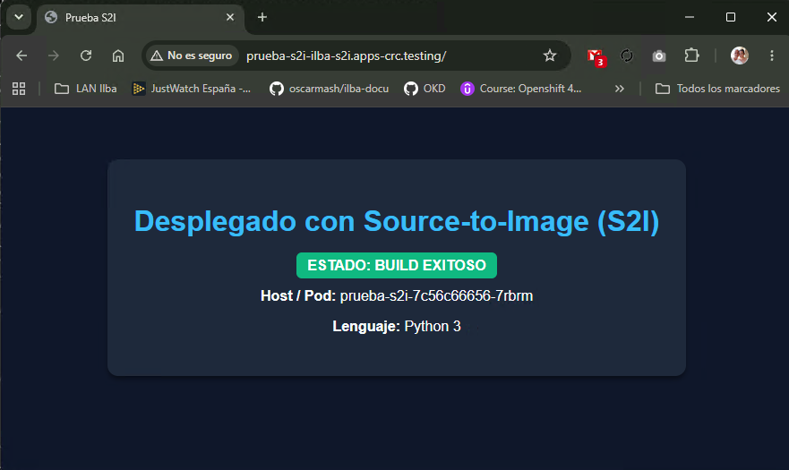

# S2I (Source-to-Image)


```
$ cat app.py
from http.server import HTTPServer, BaseHTTPRequestHandler
import os

class SimpleHandler(BaseHTTPRequestHandler):
    def do_GET(self):
        self.send_response(200)
        self.send_header('Content-type', 'text/html; charset=utf-8')
        self.end_headers()

        hostname = os.uname().nodename
        html = f"""
        <!DOCTYPE html>
        <html>
        <head>
            <title>Prueba S2I</title>
            <style>
                body {{ font-family: sans-serif; background: #0f172a; color: #f8fafc; text-align: center; padding: 50px; }}
                .card {{ background: #1e293b; padding: 30px; border-radius: 12px; display: inline-block; box-shadow: 0 4px 6px -1px rgba(0,0,0,0.5); }}
                h1 {{ color: #38bdf8; }}
                .badge {{ background: #10b981; color: white; padding: 6px 12px; border-radius: 6px; font-weight: bold; }}
            </style>
        </head>
        <body>
            <div class="card">
                <h1>Desplegado con Source-to-Image (S2I)</h1>
                <p><span class="badge">ESTADO: BUILD EXITOSO</span></p>
                <p><strong>Host / Pod:</strong> {hostname}</p>
                <p><strong>Lenguaje:</strong> Python 3</p>
            </div>
        </body>
        </html>
        """
        self.wfile.write(html.encode('utf-8'))

if __name__ == '__main__':
    # Las imágenes S2I de OpenShift/OKD usan por defecto el puerto 8080 para usuarios no privilegiados
    server = HTTPServer(('0.0.0.0', 8080), SimpleHandler)
    print("Servidor escuchando en el puerto 8080...")
    server.serve_forever()
```

```
$ touch requirements.txt
$ git add . && git commit -m "S2I" && git push
```

```
PS C:\Users\Gamer> oc new-project ilba-s2i
PS C:\Users\Gamer> oc project ilba-s2i
PS C:\Users\Gamer> oc new-app registry.access.redhat.com/ubi9/python-39~https://github.com/oscarmash/testing.git --name=prueba-s2i
```

```
PS C:\Users\Gamer> oc get bc
NAME         TYPE     FROM   LATEST
prueba-s2i   Source   Git    1
```

Si queremos relanzar la compilación:

```
$ oc start-build prueba-s2i --follow -n ilba-s2i
```

```
PS C:\Users\Gamer> oc get pods
NAME                          READY   STATUS      RESTARTS   AGE
prueba-s2i-2-build            0/1     Completed   0          5m18s
prueba-s2i-7c56c66656-7rbrm   1/1     Running     0          4m26s
```

```
PS C:\Users\Gamer> oc expose svc/prueba-s2i

PS C:\Users\Gamer> oc get route
NAME         HOST/PORT                              PATH   SERVICES     PORT       TERMINATION   WILDCARD
prueba-s2i   prueba-s2i-ilba-s2i.apps-crc.testing          prueba-s2i   8080-tcp                 None
```

