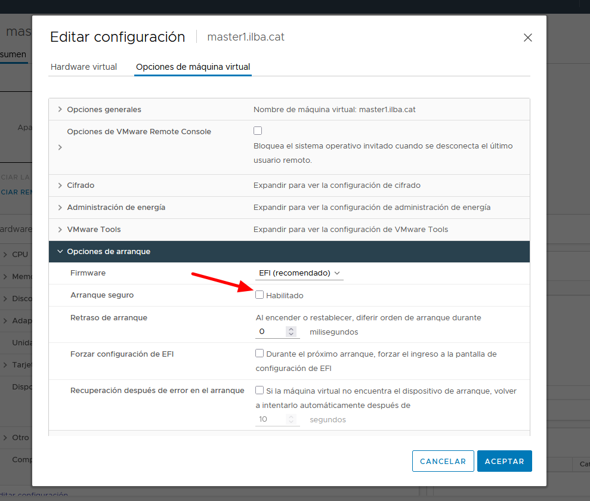
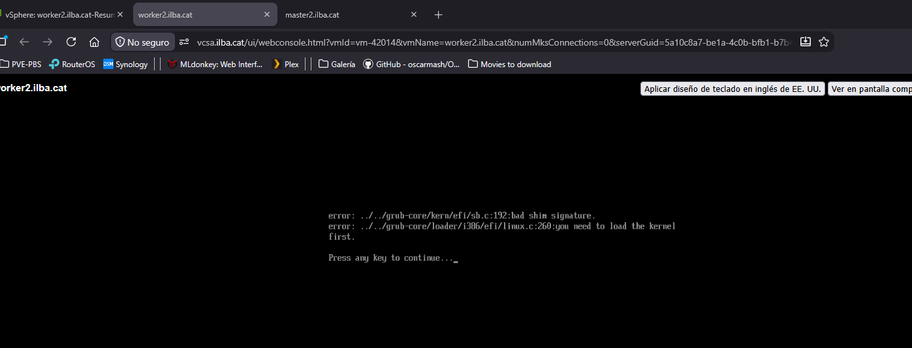
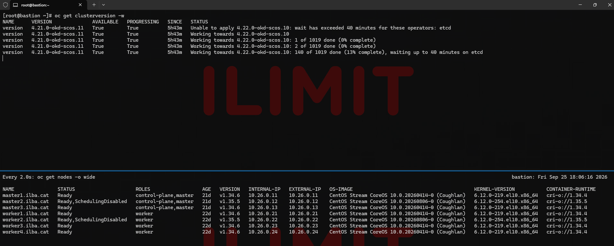

# Cluster Version Operator (CVO)

- [Validaciones previas](#validaciones-previas)
- [Actualización](#actualización)
  - [Update minor version (4.21.0-okd-scos.9 to 4.21.0-okd-scos.11)](#update-minor-version-4210-okd-scos9-to-4210-okd-scos11)
  - [Update major version (4.21.0-okd-scos.11 to 4.22.0-okd-scos.10)](#update-major-version-4210-okd-scos11-to-4220-okd-scos10)
- [Troubleshooting](#troubleshooting)

# Validaciones previas

Es indispensable deshabilitar el "Secure Boot":

* Accede a la interfaz web de vCenter o ESXi.
* Apaga la VM.
* Haz clic derecho sobre la VM $\rightarrow$ Edit Settings (Editar configuración).
* En la pestaña VM Options (Opciones de máquina virtual).Despliega la sección Boot Options (Opciones de arranque).
* En el apartado Firmware, asegúrate de que el firmware sea EFI y *desmarca* la casilla Secure Boot (Arranque seguro)
* Guarda los cambios y enciende la VM



Si deshabilitas el "Secure Boot" y reiniciamos, nos encontraremos este error al actualizar:



Estado general de los operadores del clúster (ClusterOperators)

```
[root@bastion ~]# oc get co
NAME                                       VERSION             AVAILABLE   PROGRESSING   DEGRADED   SINCE   MESSAGE
authentication                             4.21.0-okd-scos.9   True        False         False      9m56s
baremetal                                  4.21.0-okd-scos.9   True        False         False      17d
cloud-controller-manager                   4.21.0-okd-scos.9   True        False         False      17d
...
```

Estado de los nodos y MachineConfigPools (MCP)

```
[root@bastion ~]# oc get nodes
NAME               STATUS   ROLES                  AGE   VERSION
master1.ilba.cat   Ready    control-plane,master   16d   v1.34.4
master2.ilba.cat   Ready    control-plane,master   16d   v1.34.4
master3.ilba.cat   Ready    control-plane,master   16d   v1.34.4
worker1.ilba.cat   Ready    worker                 17d   v1.34.4
worker2.ilba.cat   Ready    worker                 17d   v1.34.4
worker3.ilba.cat   Ready    worker                 17d   v1.34.4
worker4.ilba.cat   Ready    worker                 17d   v1.34.4

[root@bastion ~]# oc get mcp
NAME     CONFIG                                             UPDATED   UPDATING   DEGRADED   MACHINECOUNT   READYMACHINECOUNT   UPDATEDMACHINECOUNT   DEGRADEDMACHINECOUNT   AGE
master   rendered-master-40e731a6229544cde9d572c9816da07a   True      False      False      3              3                   3                     0                      17d
worker   rendered-worker-35819a03217b78066601f159b430dcea   True      False      False      4              4                   4                     0                      17d
```

Saber en la versión que estamos actualmente:

```
[root@bastion ~]# oc get clusterversion
NAME      VERSION             AVAILABLE   PROGRESSING   SINCE   STATUS
version   4.21.0-okd-scos.9   True        False         16d     Cluster version is 4.21.0-okd-scos.9
```

Ver que todo esté bien:

> El bloqueo de actulización a la versión 4.22 es por el cambio de gestión de imágenes de arranque en vSphere. Pero primero aplicaremos los parches de la 4.21 y luego aceptaremos el cambio para pasar a la 4.22

```
[root@bastion ~]# oc adm upgrade
Cluster version is 4.21.0-okd-scos.9

Upgradeable=False

  Reason: AdminAckRequired
  Message: This cluster is Azure or vSphere but lacks a boot image configuration. OCP will automatically opt this cluster into boot image management in 4.22. Please add a configuration to disable boot image updates if this is not desired. See https://docs.redhat.com/en/documentation/openshift_container_platform/4.21/html/machine_configuration/mco-update-boot-images#mco-update-boot-images-disable_machine-configs-configure for more details.

Upstream: https://amd64.origin.releases.ci.openshift.org/graph
Channel: stable-scos-4

Recommended updates:

  VERSION            IMAGE
  4.22.0-okd-scos.0  registry.ci.openshift.org/origin/release-scos@sha256:018b65c9bd7fb045c7557e46665dacfa979ebe31d112c82b7c551ffe04e7f70f
  4.21.0-okd-scos.11 registry.ci.openshift.org/origin/release-scos@sha256:4b930ee653c7e7671cf2d69e50a1898330556a09ac58b255fbe4b8addd53b290
  4.21.0-okd-scos.10 registry.ci.openshift.org/origin/release-scos@sha256:6e55d5ec331e548bd7698e04b5e1459bc4f840c1d155858cc7e42364bd77a59
```

# Actualización

## Update minor version (4.21.0-okd-scos.9 to 4.21.0-okd-scos.11)

Nos mantenemos en la versión 4.21 y aplicamos los parches (Recomendado antes del salto)

```
[root@bastion ~]# oc get clusterversion
NAME      VERSION             AVAILABLE   PROGRESSING   SINCE   STATUS
version   4.21.0-okd-scos.9   True        False         16d     Cluster version is 4.21.0-okd-scos.9
```

```
[root@bastion ~]# oc adm upgrade --to=4.21.0-okd-scos.11
Requested update to 4.21.0-okd-scos.11
```

Proceso:

[CVO descarga Payload] ──> [Actualización Operadores] ──> [MCO actualiza Nodos] ──> [Completado]

Verificamos que ha aceptado la actualización:

```
[root@bastion ~]# oc get clusterversion version -o jsonpath='{"Deseada: "}{.spec.desiredUpdate.version}{"\nActual: "}{.status.desired.version}{"\n"}'
Deseada: 4.21.0-okd-scos.11
Actual: 4.21.0-okd-scos.9
```

Hacemos seguimiento:

```
[root@bastion ~]# oc get pods -n openshift-cluster-version
NAME                                       READY   STATUS      RESTARTS      AGE
cluster-version-operator-6596b5f4b-bc827   1/1     Running     1 (70s ago)   111s
version-4.21.0-okd-scos.11-zv8kt           0/1     Completed   0             2m18s
```

> En caso de fallo en la descarga anterior, para forzar al CVO que reintente descargar el payload, lanzarr el siguiente comando:

```
[root@bastion ~]# oc rollout restart deployment/cluster-version-operator -n openshift-cluster-version
```

Hecemos seguimiento de la actualización:

```
[root@bastion ~]# oc get clusterversion -w
NAME      VERSION             AVAILABLE   PROGRESSING   SINCE   STATUS
version   4.21.0-okd-scos.9   True        True          2m58s   Working towards 4.21.0-okd-scos.11: 120 of 970 done (12% complete), waiting on etcd, kube-apiserver
version   4.21.0-okd-scos.9   True        True          8m3s    Working towards 4.21.0-okd-scos.11: 122 of 970 done (12% complete), waiting on kube-apiserver
version   4.21.0-okd-scos.9   True        True          12m     Working towards 4.21.0-okd-scos.11: 142 of 970 done (14% complete), waiting on kube-controller-manager, kube-scheduler
version   4.21.0-okd-scos.9   True        True          18m     Working towards 4.21.0-okd-scos.11: 143 of 970 done (14% complete), waiting on kube-controller-manager
...
version   4.21.0-okd-scos.9   True        True          31m     Working towards 4.21.0-okd-scos.11: 759 of 970 done (78% complete), waiting on monitoring, openshift-apiserver
version   4.21.0-okd-scos.9   True        True          35m     Working towards 4.21.0-okd-scos.11: 761 of 970 done (78% complete), waiting on openshift-apiserver
version   4.21.0-okd-scos.9   True        True          40m     Working towards 4.21.0-okd-scos.11: 772 of 970 done (79% complete), waiting on olm
version   4.21.0-okd-scos.9   True        True          41m     Working towards 4.21.0-okd-scos.11: 795 of 970 done (81% complete), waiting on dns, network
...
```

Estado de los equipos antes de la actualización:

```
[root@bastion ~]# oc get nodes -o wide
NAME               STATUS   ROLES                  AGE   VERSION   INTERNAL-IP   EXTERNAL-IP   OS-IMAGE                                          KERNEL-VERSION           CONTAINER-RUNTIME
master1.ilba.cat   Ready    control-plane,master   17d   v1.34.4   10.26.0.11    10.26.0.11    CentOS Stream CoreOS 10.0.20260307-0 (Coughlan)   6.12.0-212.el10.x86_64   cri-o://1.34.4
master2.ilba.cat   Ready    control-plane,master   17d   v1.34.4   10.26.0.12    10.26.0.12    CentOS Stream CoreOS 10.0.20260307-0 (Coughlan)   6.12.0-212.el10.x86_64   cri-o://1.34.4
master3.ilba.cat   Ready    control-plane,master   17d   v1.34.4   10.26.0.13    10.26.0.13    CentOS Stream CoreOS 10.0.20260307-0 (Coughlan)   6.12.0-212.el10.x86_64   cri-o://1.34.4
worker1.ilba.cat   Ready    worker                 18d   v1.34.4   10.26.0.21    10.26.0.21    CentOS Stream CoreOS 10.0.20260307-0 (Coughlan)   6.12.0-212.el10.x86_64   cri-o://1.34.4
worker2.ilba.cat   Ready    worker                 18d   v1.34.4   10.26.0.22    10.26.0.22    CentOS Stream CoreOS 10.0.20260307-0 (Coughlan)   6.12.0-212.el10.x86_64   cri-o://1.34.4
worker3.ilba.cat   Ready    worker                 18d   v1.34.4   10.26.0.23    10.26.0.23    CentOS Stream CoreOS 10.0.20260307-0 (Coughlan)   6.12.0-212.el10.x86_64   cri-o://1.34.4
worker4.ilba.cat   Ready    worker                 18d   v1.34.4   10.26.0.24    10.26.0.24    CentOS Stream CoreOS 10.0.20260307-0 (Coughlan)   6.12.0-212.el10.x86_64   cri-o://1.34.4
```

Una vez acabada la actualización:

```
[root@bastion ~]# oc get clusterversion
NAME      VERSION              AVAILABLE   PROGRESSING   SINCE   STATUS
version   4.21.0-okd-scos.11   True        False         57m     Cluster version is 4.21.0-okd-scos.11
```

```
[root@bastion ~]# oc get nodes -o wide
NAME               STATUS   ROLES                  AGE   VERSION   INTERNAL-IP   EXTERNAL-IP   OS-IMAGE                                          KERNEL-VERSION           CONTAINER-RUNTIME
master1.ilba.cat   Ready    control-plane,master   17d   v1.34.6   10.26.0.11    10.26.0.11    CentOS Stream CoreOS 10.0.20260414-0 (Coughlan)   6.12.0-219.el10.x86_64   cri-o://1.34.4
master2.ilba.cat   Ready    control-plane,master   17d   v1.34.6   10.26.0.12    10.26.0.12    CentOS Stream CoreOS 10.0.20260414-0 (Coughlan)   6.12.0-219.el10.x86_64   cri-o://1.34.4
master3.ilba.cat   Ready    control-plane,master   17d   v1.34.6   10.26.0.13    10.26.0.13    CentOS Stream CoreOS 10.0.20260414-0 (Coughlan)   6.12.0-219.el10.x86_64   cri-o://1.34.4
worker1.ilba.cat   Ready    worker                 18d   v1.34.6   10.26.0.21    10.26.0.21    CentOS Stream CoreOS 10.0.20260414-0 (Coughlan)   6.12.0-219.el10.x86_64   cri-o://1.34.4
worker2.ilba.cat   Ready    worker                 18d   v1.34.6   10.26.0.22    10.26.0.22    CentOS Stream CoreOS 10.0.20260414-0 (Coughlan)   6.12.0-219.el10.x86_64   cri-o://1.34.4
worker3.ilba.cat   Ready    worker                 18d   v1.34.6   10.26.0.23    10.26.0.23    CentOS Stream CoreOS 10.0.20260414-0 (Coughlan)   6.12.0-219.el10.x86_64   cri-o://1.34.4
worker4.ilba.cat   Ready    worker                 18d   v1.34.6   10.26.0.24    10.26.0.24    CentOS Stream CoreOS 10.0.20260414-0 (Coughlan)   6.12.0-219.el10.x86_64   cri-o://1.34.4
```

## Update major version (4.21.0-okd-scos.11 to 4.22.0-okd-scos.10)

```
[root@bastion ~]# oc adm upgrade
Cluster version is 4.21.0-okd-scos.11

Upgradeable=False

  Reason: AdminAckRequired
  Message: This cluster is Azure or vSphere but lacks a boot image configuration. OCP will automatically opt this cluster into boot image management in 4.22. Please add a configuration to disable boot image updates if this is not desired. See https://docs.redhat.com/en/documentation/openshift_container_platform/4.21/html/machine_configuration/mco-update-boot-images#mco-update-boot-images-disable_machine-configs-configure for more details.

Upstream: https://amd64.origin.releases.ci.openshift.org/graph
Channel: stable-scos-4

Recommended updates:

  VERSION            IMAGE
  4.22.0-okd-scos.10 registry.ci.openshift.org/origin/release-scos@sha256:65f272bc84b5e235aa7f3026f08d69f00adebc3fd1228ea7f29e99c5580165af
  4.22.0-okd-scos.9  registry.ci.openshift.org/origin/release-scos@sha256:ec8d6dc47890317f33f435200bd7b2de7746c84f2c3d3c39d38510fd9aec6833
  4.22.0-okd-scos.8  registry.ci.openshift.org/origin/release-scos@sha256:65141d97096e2f81b35e212c7fa22c5265c23479130552e2ef25a7012e400cdb
  4.22.0-okd-scos.7  registry.ci.openshift.org/origin/release-scos@sha256:790386476b24e1a1043aa865c98d2bfeebdd467aa54859f0f53ecd6c487a8036
  4.22.0-okd-scos.6  registry.ci.openshift.org/origin/release-scos@sha256:f82cfb607a7b66a295f5b727bc53607dc65f8608a6165283b6eedc2435c718fb
  4.22.0-okd-scos.5  registry.ci.openshift.org/origin/release-scos@sha256:8ea47e23f3de5475aa1161881ccb961d6a084895ecb940d6defb8c24267322ff
  4.22.0-okd-scos.4  registry.ci.openshift.org/origin/release-scos@sha256:79dea1961581c52b6b1674a318be012c1560acccfdf8954be46b06eaf8ca5307
  4.22.0-okd-scos.3  registry.ci.openshift.org/origin/release-scos@sha256:8bef53040d3365f52090b205f45f77da9834762740eb5a71db9804e4775a1701
  4.22.0-okd-scos.2  registry.ci.openshift.org/origin/release-scos@sha256:be199cd105e876d43de410e34ea953b67851cea185c25046e5a93e1084eac6a0
  4.22.0-okd-scos.1  registry.ci.openshift.org/origin/release-scos@sha256:1e9254d3a0b3351870e14b3c837a28adbdda09b3c21f2f8d19d8c5056d7ea4d1
  4.22.0-okd-scos.0  registry.ci.openshift.org/origin/release-scos@sha256:018b65c9bd7fb045c7557e46665dacfa979ebe31d112c82b7c551ffe04e7f70f
```

```
[root@bastion ~]# oc adm upgrade --to=4.22.0-okd-scos.10
Requested update to 4.22.0-okd-scos.10

[root@bastion ~]# oc get clusterversion version -o jsonpath='{"Deseada: "}{.spec.desiredUpdate.version}{"\nActual: "}{.status.desired.version}{"\n"}'
Deseada: 4.22.0-okd-scos.10
Actual: 4.21.0-okd-scos.11
```

```
[root@bastion ~]# oc patch configmap admin-acks -n openshift-config --type merge -p '{"data":{"ack-4.21-boot-image-management":"true","ack-4.22-boot-image-management":"true"}}'
[root@bastion ~]# oc delete pod -l k8s-app=cluster-version-operator -n openshift-cluster-version
```

```
[root@bastion ~]# oc adm upgrade --to=4.22.0-okd-scos.10 --force
```



# troubleshooting

```
[root@bastion ~]# oc logs -n openshift-cluster-version deployment/cluster-version-operator --tail=80 | grep -E 'error|MultipleErrors|failed'
[root@bastion ~]# oc get events -n openshift-cluster-version --sort-by='.lastTimestamp' | tail -n 20
[root@bastion ~]# oc describe clusterversion version
[root@bastion ~]# oc adm upgrade
```

