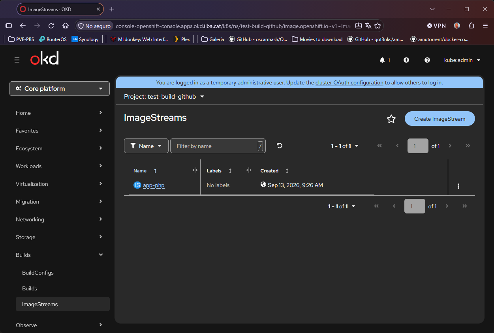

# Concepto y uso de Project vs Namespace

Históricamente, el Namespace existió antes en el motor de Kubernetes, pero el concepto de Project nació porque el Namespace original era insuficiente para entornos empresariales.

Un Project es una capa de abstracción sobre un Namespace estándar de Kubernetes. 
Cada vez que se crea un Project, OpenShift crea y mapea por debajo un Namespace con el mismo nombre.

Cuando hemos de crear Namespaces o Projects:
* Crear directamente un Namespace: es la práctica estándar para componentes de infraestructura, operadores y middleware del clúster
* Crear un Project: es el enfoque idóneo para aplicaciones de usuarios y desarrolladores

# Project vs NS

| Característica | **Namespace** (Kubernetes nativo) | **Project** (OpenShift / OKD) |
| :--- | :--- | :--- |
| **API / Origen** | Nativo de Kubernetes (`k8s.io` / `v1`) | Extensión de OpenShift (`project.openshift.io/v1`) |
| **Comando CLI** | `kubectl get namespaces` o `oc get ns` | `oc project` o `oc get projects` |
| **Autoaprovisionamiento y permisos** | Requiere permisos de administrador de clúster para crearse | Los usuarios no administradores pueden crearlo por autoservicio (`oc new-project`) mediante `ProjectRequest` |
| **RBAC automático** | No asigna roles por defecto al creador | Asigna automáticamente el rol de `admin` local al usuario creador |
| **Plantillas automáticas** | No dispara mecanismos de plantillas al crearse | Permite aplicar `ProjectRequestTemplate` que inyecta cuotas (`ResourceQuota`), límites (`LimitRanges`) o `NetworkPolicies` |
| **Metadatos adicionales** | Solo admite etiquetas y anotaciones genéricas | Incorpora campos específicos como `displayName` (nombre legible) y `description` para la consola web |


# RBAC

## ServiceAccount

Dentro de cada Project, se crea automáticamente unos SA (ServicesAccount) para que las aplicaciones funcionen sin configuración previa. Las SA que se crean por defecto son:

* default: La identidad bajo la que corren los Pods por defecto (sometida a la SCC restricted-v2).
* builder: Cuenta utilizada por los builds internos / S2I para compilar y empujar imágenes al registro local.
* deployer: Cuenta histórica encargada de desplegar pods durante los rollouts de ReplicationControllers / DeploymentConfigs.

```
[root@bastion ~]# oc get sa -n <name_project>
NAME       SECRETS   AGE
builder    2         10s
default    2         10s
deployer   2         10s
```

## Roles

Cuando creamos un proyecto, se le asigna automáticamente el rol de `admin` local al usuario que lo ha creado. Esto le da las siguientes ventajas al usuario:
* Puede crear, modificar y eliminar Deployments, Pods, Services, Routes, ConfigMaps, Secrets, etc...
* Puede crear Pipelines y CI/CD (Tekton)
* Puede revisar eventos, logs de contenedores y depurar errores de sus aplicaciones.

# Restricciones

En OpenShift y Kubernetes, los proyectos sirven para aislar aplicaciones y recursos. Existen una series de restricciones:

* Protección del plano de control (Control Plane): Los prefijos kube- (heredado de Kubernetes, como kube-system o kube-public) y openshift- (como openshift-monitoring, openshift-ingress, etc.) están reservados para componentes internos de la infraestructura, operadores del sistema y servicios críticos de la plataforma. Por consiguiente no podremos crear Namespaces que empiezen con ese nombre.

```
[root@bastion ~]# oc new-project openshift-ilba \
  --display-name="Project Ilba" \
  --description="Entorno de microservicios para Ilba"
Error from server (Forbidden): project.project.openshift.io "openshift-ilba" is forbidden: cannot request a project starting with "openshift-"
```

* Diferencias entre usuario y administrador:
  * *oc new-project*: está pensado para los usuarios normales o cargas de trabajo de clientes. Aplica plantillas por defecto (project request templates), asigna cuotas automáticas y cuenta con validaciones de seguridad para evitar que un usuario común cree accidentalmente un proyecto que suplante o interfiera con el sistema.
  * *oc adm new-project*: es para administradores. Omite las restricciones de prefijo (Protección del plano de control).

# Selectores de nodos por proyecto

Si un proyecto lleva la anotación *openshift.io/node-selector: "node-role.kubernetes.io/infra="*, todos los pods creados en ese proyecto se agendarán automáticamente solo en esos nodos, sin necesidad de que el desarrollador configure nodeSelector a mano en sus despliegues.

Si una persona define un *nodeSelector* propio en su despliegue, OpenShift solo lo permitirá si coincide con el *node-selector* del proyecto; si entra en conflicto, el admission controller rechazará el pod.

Si la anotación se deja vacía (*openshift.io/node-selector: ""*), se anula cualquier selector predeterminado a nivel de clúster, permitiendo que los pods de ese proyecto puedan agendarse en cualquier nodo sin restricciones.

# Runlevels en OpenShift

Igual que en los sistemas operativos, OpenShift utiliza el concepto de runlevels mediante la etiqueta o anotación *openshift.io/run-level*.
Los proyectos asignados a los niveles 0 o 1 tienen la máxima prioridad durante el arranque y recuperación del clúster, ya que es donde etán ubicados los componentes más críticos de la infraestructura de Kubernetes.

```
[root@bastion ~]# oc get namespaces -L openshift.io/run-level
NAME                                STATUS   AGE   RUN-LEVEL
default                             Active   10d   0
kube-system                         Active   10d   0
openshift-etcd                      Active   10d   1
openshift-kube-apiserver            Active   10d   1
openshift-ingress                   Active   10d   
my-app                              Active   2d
```

Niveles de runlevels:
* Run-level 0: es el núcleo del sistema (kube-system, default, etc...), necesario para que la API empiece a responder.
* Run-level 1: son los servicios esenciales del plano de control gestionados por operadores estáticos (como openshift-etcd, openshift-kube-apiserver, openshift-kube-controller-manager, etc...).
* Run-level "sin valor": son los Namespaces de los usuarios. Cargas de trabajo normales que no son críticas para el sistema.

# Desactivar el auto-aprovisionamiento (self-provisioner)

Por defecto, OpenShift está configurado bajo una filosofía de autoservicio (self-service): cualquier usuario que inicie sesión con éxito en el clúster recibe automáticamente el rol de clúster self-provisioner, lo que le permite crear proyectos a su antojo usando oc new-project o desde la consola web. En muchas empresas o entornos de producción se retira el rol self-provisioner para evirtar *Project Sprawl*, cumplimiento de *compliance*, control de costes y cuotas, etc....

```
$ oc adm policy remove-cluster-role-from-group self-provisioner system:authenticated:oauth
```

# Plantilla base

En OpenShift, el ProjectRequestTemplate es el mecanismo que permite definir una plantilla (Template) global con la configuración base que debe tener cualquier proyecto nuevo que se cree en el cluster. Cada vez que un usuario crea un proyecto con **oc new-project** o mediante la consola web, el clúster inyecta automáticamente los objetos que tú hayas configurado, que pueden ser los siguientes:

* ResourceQuota
* LimitRange
* NetworkPolicies

## Ejemplo de plantilla base

En este ejemplo, añadiremos los objetos que deseemos, para que cuando se cree un proyecto se cree con nuestras características personalizadas:

```
apiVersion: template.openshift.io/v1
kind: Template
metadata:
  name: custom-project-template
  namespace: openshift-config
parameters:
- name: PROJECT_NAME
- name: PROJECT_DISPLAY_NAME
- name: PROJECT_DESCRIPTION
- name: PROJECT_ADMIN_USER
objects:
- apiVersion: project.openshift.io/v1
  kind: Project
  metadata:
    name: ${PROJECT_NAME}
    annotations:
      openshift.io/display-name: ${PROJECT_DISPLAY_NAME}
      openshift.io/description: ${PROJECT_DESCRIPTION}
- apiVersion: rbac.authorization.k8s.io/v1
  kind: RoleBinding
  metadata:
    name: admin
    namespace: ${PROJECT_NAME}
  roleRef:
    apiGroup: rbac.authorization.k8s.io
    kind: ClusterRole
    name: admin
  subjects:
  - apiGroup: rbac.authorization.k8s.io
    kind: User
    name: ${PROJECT_ADMIN_USER}
- apiVersion: v1
  kind: ResourceQuota
  metadata:
    name: default-quota
    namespace: ${PROJECT_NAME}
  spec:
    hard:
      requests.cpu: "2"
      requests.memory: 4Gi
      limits.cpu: "4"
      limits.memory: 8Gi
      pods: "10"
- apiVersion: v1
  kind: LimitRange
  metadata:
    name: default-limits
    namespace: ${PROJECT_NAME}
  spec:
    limits:
    - type: Container
      default:
        cpu: 500m
        memory: 512Mi
      defaultRequest:
        cpu: 100m
        memory: 256Mi
      max:
        cpu: "2"
        memory: 2Gi
      min:
        cpu: 50m
        memory: 64Mi
- apiVersion: networking.k8s.io/v1
  kind: NetworkPolicy
  metadata:
    name: allow-same-namespace
    namespace: ${PROJECT_NAME}
  spec:
    podSelector: {}
    ingress:
    - from:
      - podSelector: {}
```

Aplicar la plantilla y activarla globalmente

```
[root@bastion ~]# oc apply -n openshift-config -f manifest/custom-project-template.yaml
```

Configuraremos el recurso global de proyectos para usar la plantilla:

```
oc patch project.config.openshift.io/cluster --type=merge -p '{
  "spec": {
    "projectRequestTemplate": {
      "name": "custom-project-template"
    }
  }
}'
```

```
[root@bastion ~]# oc get template -n openshift-config
NAME                      DESCRIPTION   PARAMETERS    OBJECTS
custom-project-template                 4 (4 blank)   5
```

Cuando se crea un namespace directamente como root o cluster-admin usando comandos estándar como *oc create ns test-gobernado*, OpenShift/OKD no invoca el motor de ProjectRequestTemplate

Crearemos un nuevo proyecto:

```
[root@bastion ~]# oc new-project test-gobernado --display-name="Test Gobernado" 
```

Verificaremos que haya funcionado

```
[root@bastion ~]# oc -n test-gobernado get resourcequota
NAME            REQUEST                                                 LIMIT                                   AGE
default-quota   pods: 0/10, requests.cpu: 0/2, requests.memory: 0/4Gi   limits.cpu: 0/4, limits.memory: 0/8Gi   88s

[root@bastion ~]# oc -n test-gobernado get limitrange
NAME             CREATED AT
default-limits   2026-10-10T15:51:51Z

[root@bastion ~]# oc -n test-gobernado get networkpolicy
NAME                   POD-SELECTOR   AGE
allow-same-namespace   <none>         94s
```

Si estuvieramos en un Laboratorio, es importante hacer limpieza:

```
[root@bastion ~]# oc patch project.config.openshift.io/cluster --type=json -p '[{"op": "remove", "path": "/spec/projectRequestTemplate"}]'
[root@bastion ~]# oc patch project.config.openshift.io/cluster --type=merge -p '{"spec":{"projectRequestTemplate":{"name":""}}}'
[root@bastion ~]# oc patch project.config.openshift.io/cluster --type=merge -p '{"spec":{"projectRequestTemplate":null}}'
[root@bastion ~]# oc rollout restart deployment/apiserver -n openshift-apiserver
```

# Registry privado en cada proyecto

Al dar de alta un proyecto (por ejemplo, mi-app), se crea un *Registry* interno para ese Namespace:

```
[root@bastion ~]# oc get is -n test-build-github
NAME      IMAGE REPOSITORY                                        TAGS     UPDATED
app-php   registry.172.26.0.12.nip.io/test-build-github/app-php   v1.0.0   4 weeks ago
```



Por defecto, el acceso está completamente restringido: ningún usuario ni pod de otro namespace puede hacer push (subir) ni pull (descargar). La seguridad se gestiona directamente con los roles de Kubernetes/OpenShift vinculados al proyecto. Si otro proyecto necesita descargar imágenes de este repositorio, se le debe conceder permisos explícitos al rol de su ServiceAccount.
