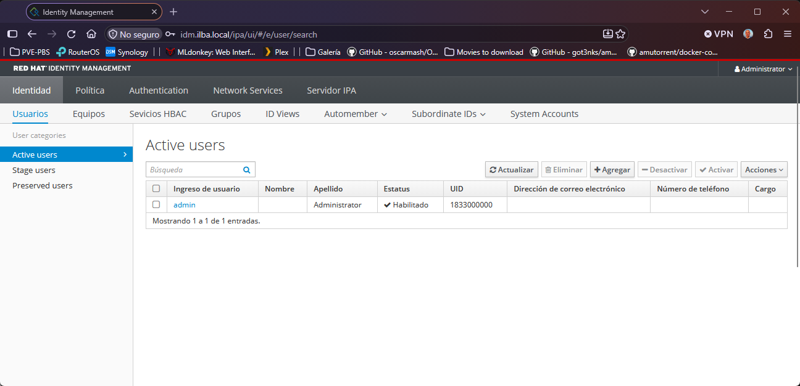

# Índice

- [Instalación de idM](#instalación-de-idm)
  - [Prerequisitos](#prerequisitos)
  - [Instalación](#instalación)
  - [Configuración de HAProxy](#configuración-de-haproxy)
  - [Acceso](#acceso)

# Instalación de idM

## Prerequisitos

Recursos para la VM en Proxmox
* RHEL10
* 2 vCPUs
* 4 GB RAM
* 60 GB de disco

## Instalación

```
[root@bastion ~]# ssh-copy-id -i .ssh/id_rsa.pub idm
[root@bastion ~]# ssh idm
```

```
[root@idm ~]# subscription-manager status
+-------------------------------------------+
   System Status Details
+-------------------------------------------+
Overall Status: Registered
```

```
[root@idm ~]# hostnamectl set-hostname idm.ilba.local
[root@idm ~]# echo "10.26.0.6  idm.ilba.local idm" >> /etc/hosts
[root@idm ~]# hostname -f
idm.ilba.local
```

```
[root@idm ~]# sed -i 's/^#UseDNS yes/UseDNS no/' /etc/ssh/sshd_config
[root@idm ~]# sed -i 's/^GSSAPIAuthentication yes/GSSAPIAuthentication no/' /etc/ssh/sshd_config
[root@idm ~]# systemctl restart sshd
```

```
[root@idm ~]# systemctl stop firewalld
[root@idm ~]# systemctl disable firewalld
[root@idm ~]# systemctl mask firewalld
```

```
[root@idm ~]# dnf upgrade -y
```

```
[root@idm ~]# dnf install -y ipa-server ipa-server-dns bind-dyndb-ldap
[root@idm ~]# dnf install -y vim
[root@idm ~]# ipa-server-install --setup-dns
  Server host name [idm.ilba.local]:
  Please confirm the domain name [ilba.local]:
  Please provide a realm name [ILBA.LOCAL]:
  Directory Manager password: C@dinor1988   <- administrador del motor LDAP
  IPA admin password: C@dinor1988           <- usuario admin de la consola web y Kerberos
  Do you want to configure DNS forwarders? [yes]:
  Following DNS servers are configured in /etc/resolv.conf: 10.26.0.5
  Do you want to configure these servers as DNS forwarders? [yes]:
  Do you want to search for missing reverse zones? [yes]:
  NetBIOS domain name [ILBA]:
  Do you want to configure chrony with NTP server or pool address? [no]:
  Continue to configure the system with these values? [no]: yes
```

## Configuración de HAProxy

```
[root@bastion ~]# vim /etc/haproxy/haproxy.cfg
...
# ---------------------------------------------------------------------
# INGRESS HTTPS (Puerto 443)
# ---------------------------------------------------------------------
frontend okd_https_ingress_frontend
    bind 10.26.0.5:443
    mode tcp
    option tcplog

    # Desvío hacia IDM por SNI
    tcp-request inspect-delay 5s
    tcp-request content accept if { req_ssl_hello_type 1 }
    use_backend idm_https_backend if { req_ssl_sni -i idm.ilba.local }

    default_backend okd_https_ingress_backend

backend idm_https_backend
    mode tcp
    server idm 10.26.0.6:443 check

backend okd_https_ingress_backend
    mode tcp
    balance roundrobin
    server worker1 10.26.0.21:443 check
    server worker2 10.26.0.22:443 check
    server worker3 10.26.0.23:443 check
    server worker4 10.26.0.24:443 check
    server worker5 10.26.0.25:443 check
    server worker6 10.26.0.26:443 check
...
```

## Acceso

Datos de acceso:
* URL: https://idm.ilba.local
* Username: admin
* Password: C@dinor1988


