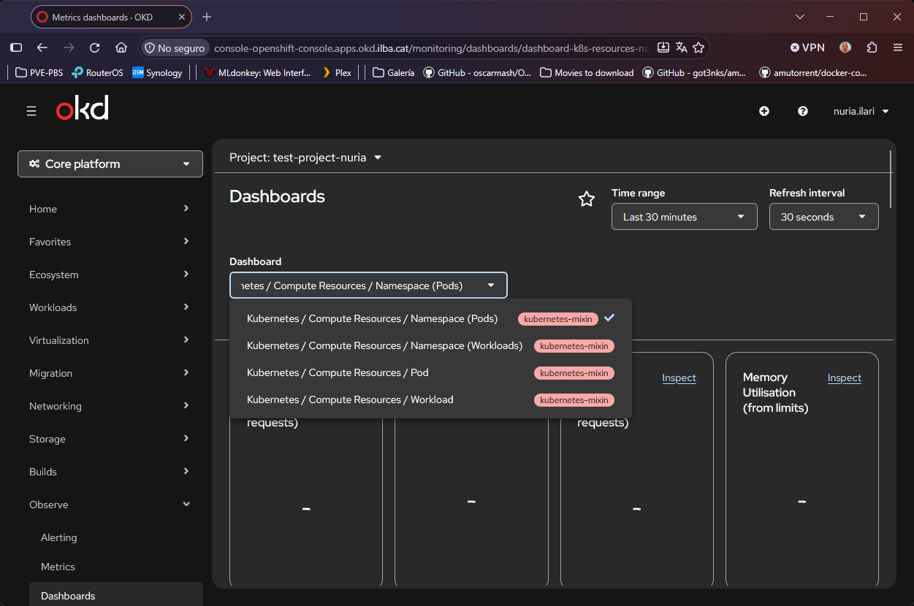
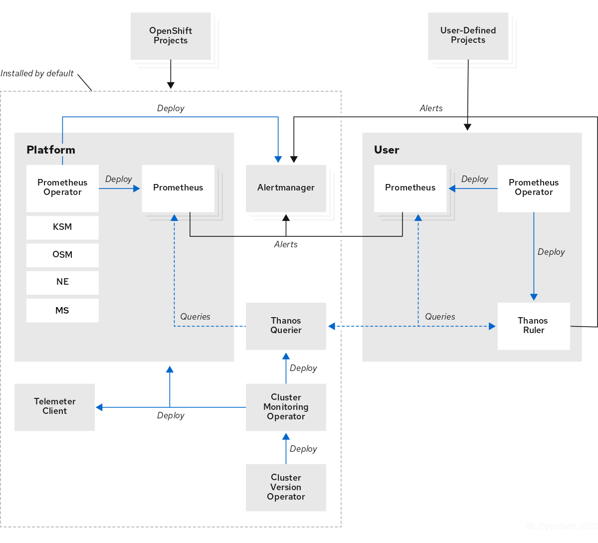
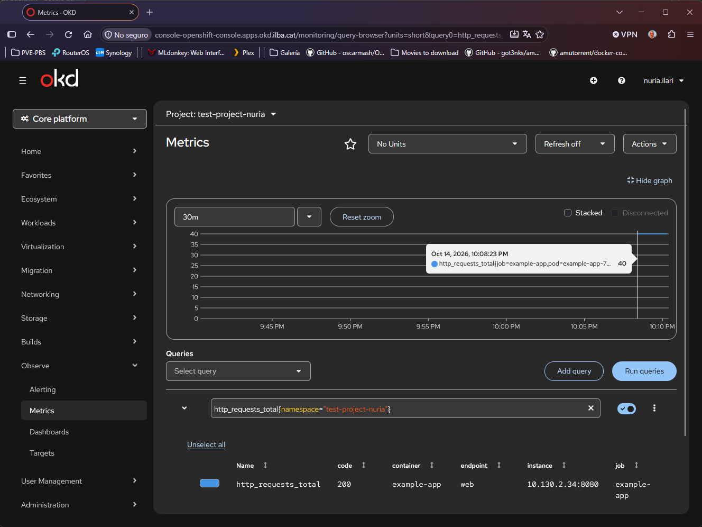

## Índice

- [User Workload Monitoring (UWM): Arquitectura](#user-workload-monitoring-uwm-arquitectura)
  - [Desacoplamiento total y aislamiento](#desacoplamiento-total-y-aislamiento)
  - [Almacenamiento](#almacenamiento)
- [Despliegue de prueba](#despliegue-de-prueba)
- [Activación del User Workload](#activación-del-user-workload)
  - [Activación por el Administrador](#activación-por-el-administrador)
  - [Configuración del UWM](#configuración-del-uwm)

# User Workload Monitoring (UWM): Arquitectura

Por defecto, OpenShift sólo vigila la infraestructura interna y User Workload Monitoring (UWM) es el mecanismo de OpenShift/OKD que desacopla la monitorización de la plataforma (nodos, API Server, etcd) de las aplicaciones y servicios desarrollados por los usuarios.

Cuando activas UWM, el Cluster Monitoring Operator (CMO) despliega automáticamente una infraestructura paralela dedicada:
* Namespace dedicado: Crea el namespace openshift-user-workload-monitoring.
* Componentes desplegados:
  * prometheus-operator: Gestiona el ciclo de vida de los monitores en los proyectos.
  * prometheus-user-workload: Par de réplicas en StatefulSet encargadas de hacer el scrape a tus pods.
  * thanos-ruler-user-workload: Evalúa reglas de alerta (PrometheusRule) definidas en proyectos de usuario.

```
[root@bastion ~]# oc -n openshift-user-workload-monitoring get pods
NAME                                   READY   STATUS    RESTARTS   AGE
prometheus-operator-6dbb47f6d5-j847p   2/2     Running   0          23m
prometheus-user-workload-0             5/6     Running   0          18s
prometheus-user-workload-1             6/6     Running   0          18s
thanos-ruler-user-workload-0           4/4     Running   0          2m3s
thanos-ruler-user-workload-1           4/4     Running   48         19d
```

Esto es lo que ve un usuario haciendo login en la GUI de OKD:



Si no activamos el UWM, el usuario podrá ver gráficas de :
* CPU consumida
* Memoria RAM
* Tráfico de red

Que ganamos con UWM ?:
* Recolectar métricas expuestas en endpoints /metrics
* Alertas personalizadas en el propio proyecto
* etc...

Como funciona:
* Activación por el Administrador
* Configuración del UWM

## Desacoplamiento total y aislamiento

Este sistema diseñó esta arquitectura en dos namespaces (openshift-monitoring y openshift-user-workload-monitoring) para garantizar que:

* Si una aplicación de un desarrollador genera millones de métricas (problemas de alta cardinalidad de etiquetas) y satura la memoria de Prometheus, sólo se caerá la instancia de usuario (prometheus-user-workload), dejando intacto el Prometheus del clúster (prometheus-k8s).
* Las alertas del sistema operativo o del plano de control nunca se verán retrasadas o bloqueadas por cálculos de reglas complejas de los usuarios.



## Almacenamiento

Tenemos dos opciones para el almacenamiento de los datos:
* Mismo almacenamiento S3 y mismo bucket (Uso compartido)
* Buckets o instancias S3 diferentes (Aislamiento completo)

NOTA: Los PVC's de cada Prometheus, siempre estan separados en volúmenes y namespaces distintos.

# Despliegue de prueba

```
[root@bastion ~]# oc config use-context admin
[root@bastion ~]# oc whoami
system:admin
[root@bastion ~]# oc adm policy add-role-to-user monitoring-edit nuria.ilari -n test-project-nuria
[root@bastion ~]# oc adm policy add-role-to-user monitoring-rules-view nuria.ilari -n test-project-nuria
```

```
[root@bastion ~]# oc login https://api.okd.ilba.cat:6443 -u nuria.ilari -p Password123 --insecure-skip-tls-verify=true
[root@bastion ~]# oc whoami
nuria.ilari
[root@bastion ~]# oc project test-project-nuria
```

```
[root@bastion ~]# vim manifest/test-UWM.yaml
apiVersion: apps/v1
kind: Deployment
metadata:
  name: example-app
  namespace: test-project-nuria
  labels:
    app: example-app
spec:
  replicas: 1
  selector:
    matchLabels:
      app: example-app
  template:
    metadata:
      labels:
        app: example-app
    spec:
      containers:
      - name: example-app
        image: quay.io/brancz/prometheus-example-app:v0.5.0
        ports:
        - name: web
          containerPort: 8080
---
apiVersion: v1
kind: Service
metadata:
  name: example-app
  namespace: test-project-nuria
  labels:
    app: example-app
spec:
  ports:
  - name: web
    port: 8080
    targetPort: web
  selector:
    app: example-app
---
apiVersion: monitoring.coreos.com/v1
kind: ServiceMonitor
metadata:
  name: example-app-monitor
  namespace: test-project-nuria
  labels:
    k8s-app: example-app-monitor
spec:
  selector:
    matchLabels:
      app: example-app
  endpoints:
  - port: web
    path: /metrics
    interval: 15s

[root@bastion ~]# oc apply -f manifest/test-UWM.yaml
```

```
[root@bastion ~]# oc get pods
NAME                           READY   STATUS    RESTARTS   AGE
example-app-79bdc9c9c4-6tbqk   1/1     Running   0          6s

[root@bastion ~]# oc get svc
NAME          TYPE        CLUSTER-IP       EXTERNAL-IP   PORT(S)    AGE
example-app   ClusterIP   172.30.163.247   <none>        8080/TCP   19s
```

#  Activación del User Workload

## Activación por el Administrador

```
[root@bastion ~]# oc config use-context admin
```

Levantamos las instancias de Prometheus Operator, Prometheus y Thanos Ruler para usuarios

```
[root@bastion ~]# vim manifest/cluster-monitoring-config.yaml
apiVersion: v1
kind: ConfigMap
metadata:
  name: cluster-monitoring-config
  namespace: openshift-monitoring
data:
  config.yaml: |
    enableUserWorkload: true

[root@bastion ~]# oc apply -f manifest/cluster-monitoring-config.yaml
```

Configuramos la infraestructura subyacente compartida de la pila de usuario (cuánta CPU/RAM tienen los pods de Prometheus, qué StorageClass usa el StatefulSet para sus volúmenes PVC, retención global en disco o credenciales de Thanos).

```
[root@bastion ~]# vim manifest/user-workload-monitoring-config.yaml
apiVersion: v1
kind: ConfigMap
metadata:
  name: user-workload-monitoring-config
  namespace: openshift-user-workload-monitoring
data:
  config.yaml: |
    prometheus:
      retention: 24h
      volumeClaimTemplate:
        spec:
          storageClassName: thin-csi
          resources:
            requests:
              storage: 20Gi

[root@bastion ~]# oc apply -f manifest/user-workload-monitoring-config.yaml
```

```
[root@bastion ~]# oc -n openshift-user-workload-monitoring get pods
NAME                                   READY   STATUS    RESTARTS   AGE
prometheus-operator-6dbb47f6d5-j847p   2/2     Running   0          23m
prometheus-user-workload-0             5/6     Running   0          18s
prometheus-user-workload-1             6/6     Running   0          18s
thanos-ruler-user-workload-0           4/4     Running   0          2m3s
thanos-ruler-user-workload-1           4/4     Running   48         19d
```

## Configuración del UWM

```
[root@bastion ~]# oc login https://api.okd.ilba.cat:6443 -u nuria.ilari -p Password123 --insecure-skip-tls-verify=true
[root@bastion ~]# oc project test-project-nuria
```

```
[root@bastion ~]# vim manifest/PrometheusRule.yaml
apiVersion: monitoring.coreos.com/v1
kind: PrometheusRule
metadata:
  name: example-app-alerts
  namespace: test-project-nuria
  labels:
    app: example-app
spec:
  groups:
  - name: example-app.rules
    rules:
    - alert: ExampleAppHighHttpErrors
      expr: rate(http_requests_total{code=~"5.."}[1m]) > 0
      for: 30s
      labels:
        severity: critical
      annotations:
        summary: "Se han detectado errores 5xx en {{ $labels.pod }}"
    - alert: ExampleAppTrafficDetected
      expr: rate(http_requests_total{code="200"}[1m]) > 0.2
      for: 15s
      labels:
        severity: warning
      annotations:
        summary: "Tráfico detectado en {{ $labels.pod }}"

[root@bastion ~]# oc apply -f manifest/PrometheusRule.yaml
```

Lanzamos un port-forward a la aplicación, generamos 40 peticiones para probar las métricas y detenemos el port-forward:

```
oc port-forward svc/example-app 8080:8080 -n test-project-nuria &
for i in {1..40}; do curl -s http://localhost:8080/ > /dev/null; done
pkill -f "oc port-forward svc/example-app"
```


