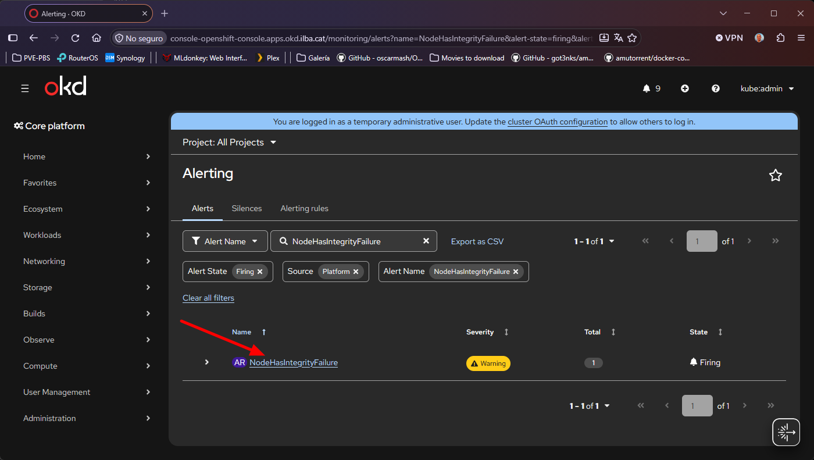

# Índice de Contenidos

- [Introducción y Funcionalidades](#introducción-y-funcionalidades)
- [Configuración del Catálogo Oficial (Red Hat Operators)](#configuración-del-catálogo-oficial-red-hat-operators)
  - [Comprobación inicial del catálogo](#comprobación-inicial-del-catálogo)
  - [Actualización del Pull Secret global](#actualización-del-pull-secret-global)
  - [Despliegue del CatalogSource](#despliegue-del-catalogsource)
- [Instalación de File Integrity Operator](#instalación-de-file-integrity-operator)
  - [Definición de Namespace, OperatorGroup y Subscription](#definición-de-namespace-operatorgroup-y-subscription)
  - [Verificación del despliegue](#verificación-del-despliegue)
- [Baseline](#baseline)
  - [Recurso FileIntegrity](#recurso-fileintegrity)
  - [Inicialización de AIDE y validación](#inicialización-de-aide-y-validación)
- [Prueba de Detección de Cambios y Auditoría](#prueba-de-detección-de-cambios-y-auditoría)
  - [Modificación no autorizada en FIO](#modificación-no-autorizada-en-fio)
  - [Detección del fallo por CLI](#detección-del-fallo-por-cli)
  - [Informe detallado de la detección](#informe-detallado-de-la-detección)
  - [Visualización de la alerta en la Consola Web (GUI)](#visualización-de-la-alerta-en-la-consola-web-gui)

# Introducción y Funcionalidades

El File Integrity Operator (FIO) en OpenShift y Kubernetes es el operador enfocado en la seguridad y el cumplimiento de las normativas (compliance), diseñado para monitorizar continuamente la integridad de los archivos del sistema operativo base (RHCOS/FCOS/SCOS) en los nodos de nuestro clúster.

Su funcionalidad es:
* Detección de intrusiones y malware: Identifica si atacantes, procesos no autorizados o binarios maliciosos han modificado archivos críticos del sistema.
* Cumplimiento normativo (Compliance): Satisface requerimientos estrictos de normativas y estándares de seguridad de nuestar empresa
* Control de desviaciones no autorizadas (drift): Advierte si un administrador o proceso externo modificó manualmente configuraciones en los nodos eludiendo el Machine Config Operator (MCO)

# Configuración del Catálogo Oficial (Red Hat Operators)

## Comprobación inicial del catálogo

Al no venir por defecto con nuestro sistema de OpenShift, lo bucaremos en el catálogo:

```
[root@bastion ~]# oc get packagemanifest -n openshift-marketplace | grep -i file-integrity
file-integrity-console-plugin               Community Operators   7d20h
```

Como se puede observar, el operador FIO no existe, por lo que tendremos que añadir el catalogo de RedHat.

## Actualización del Pull Secret global

Podremos conseguir el Token de https://console.redhat.com/openshift/install/pull-secret, pero para hemos previavemente nos hemos creado una cuenta gratuita en RedHat Developers. De aquí conseguiremos el fichero _pull-secret.txt_

```
[root@bastion ~]# oc set data secret/pull-secret -n openshift-config --from-file=.dockerconfigjson=pull-secret.txt
```

## Despliegue del CatalogSource

La versión de nuestra imagen del CatalogSource, ha de coincidir con la versión de nuestro cluster:

```
[root@bastion ~]# oc get clusterversion
NAME      VERSION              AVAILABLE   PROGRESSING   SINCE   STATUS
version   4.22.0-okd-scos.10   True        False         50m     Cluster version is 4.22.0-okd-scos.10
```

```
[root@bastion ~]# vim infra/manifest/CatalogSource_redhat-operators.yaml
apiVersion: operators.coreos.com/v1alpha1
kind: CatalogSource
metadata:
  name: redhat-operators
  namespace: openshift-marketplace
spec:
  displayName: Red Hat Operators
  image: registry.redhat.io/redhat/redhat-operator-index:v4.22
  publisher: Red Hat
  sourceType: grpc
  updateStrategy:
    registryPoll:
      interval: 15m
```

```
[root@bastion ~]# oc apply -f infra/manifest/CatalogSource_redhat-operators.yaml

[root@bastion ~]# oc get pods -n openshift-marketplace -l olm.catalogSource=redhat-operators
NAME                     READY   STATUS    RESTARTS   AGE
redhat-operators-9vtkn   1/1     Running   0          83s

[root@bastion ~]# oc get catalogsource -n openshift-marketplace
NAME                  DISPLAY               TYPE   PUBLISHER   AGE
community-operators   Community Operators   grpc   Red Hat     7d20h
redhat-operators      Red Hat Operators     grpc   Red Hat     14s

[root@bastion ~]# oc get packagemanifest -n openshift-marketplace -l catalog=redhat-operators | grep -i file-integrity
file-integrity-operator                          Red Hat Operators   2m
```

# Instalación de File Integrity Operator

## Definición de Namespace, OperatorGroup y Subscription

Creamos el manifiesto de instalación de FIO:

```
[root@bastion ~]# vim infra/manifest/install-fio.yaml
apiVersion: v1
kind: Namespace
metadata:
  name: openshift-file-integrity
  labels:
    openshift.io/cluster-monitoring: "true"
---
apiVersion: operators.coreos.com/v1
kind: OperatorGroup
metadata:
  name: file-integrity-operatorgroup
  namespace: openshift-file-integrity
spec:
  targetNamespaces:
  - openshift-file-integrity
---
apiVersion: operators.coreos.com/v1alpha1
kind: Subscription
metadata:
  name: file-integrity-operator
  namespace: openshift-file-integrity
spec:
  channel: stable
  installPlanApproval: Automatic
  name: file-integrity-operator
  source: redhat-operators
  sourceNamespace: openshift-marketplace
```

```
[root@bastion ~]# oc apply -f infra/manifest/install-fio.yaml
```

## Verificación del despliegue

```
[root@bastion ~]# oc get csv -n openshift-file-integrity
NAME                             DISPLAY                   VERSION   RELEASE   REPLACES                         PHASE
file-integrity-operator.v1.5.0   File Integrity Operator   1.5.0               file-integrity-operator.v1.4.1   Succeeded

[root@bastion ~]# oc get pods -n openshift-file-integrity
NAME                                       READY   STATUS    RESTARTS   AGE
file-integrity-operator-6d6b5fdbb5-frlxb   1/1     Running   0          2m3s
```

# Baseline

## Recurso FileIntegrity

Vamos a indicarle al operador que monitoree la integridad de los archivos del sistema operativo en los nodos con etiqueta node-role.kubernetes.io/worker (worker3 a worker6):

```
[root@bastion ~]# oc get nodes
NAME               STATUS   ROLES                  AGE     VERSION
master1.ilba.cat   Ready    control-plane,master   7d11h   v1.35.5
master2.ilba.cat   Ready    control-plane,master   7d12h   v1.35.5
master3.ilba.cat   Ready    control-plane,master   7d11h   v1.35.5
worker1.ilba.cat   Ready    infra                  7d20h   v1.35.5
worker2.ilba.cat   Ready    infra                  7d20h   v1.35.5
worker3.ilba.cat   Ready    worker                 7d20h   v1.35.5
worker4.ilba.cat   Ready    worker                 7d20h   v1.35.5
worker5.ilba.cat   Ready    worker                 2d13h   v1.35.5
worker6.ilba.cat   Ready    worker                 2d13h   v1.35.5
```

```
[root@bastion ~]# vim infra/manifest/FileIntegrity-workers.yaml
apiVersion: fileintegrity.openshift.io/v1alpha1
kind: FileIntegrity
metadata:
  name: worker-fileintegrity
  namespace: openshift-file-integrity
spec:
  nodeSelector:
    node-role.kubernetes.io/worker: ""
  config: {}
```

```
[root@bastion ~]# oc apply -f infra/manifest/FileIntegrity-workers.yaml
```

## Inicialización de AIDE y validación

```
[root@bastion ~]# oc get pods -n openshift-file-integrity -o wide
NAME                                       READY   STATUS    RESTARTS   AGE     IP            NODE               NOMINATED NODE   READINESS GATES
aide-worker-fileintegrity-4xbql            1/1     Running   0          4m30s   10.130.2.12   worker4.ilba.cat   <none>           <none>
aide-worker-fileintegrity-65kz7            1/1     Running   0          4m30s   10.131.0.6    worker3.ilba.cat   <none>           <none>
aide-worker-fileintegrity-b9xsr            1/1     Running   0          4m30s   10.128.0.8    worker6.ilba.cat   <none>           <none>
aide-worker-fileintegrity-g5bll            1/1     Running   0          4m30s   10.128.4.9    worker5.ilba.cat   <none>           <none>
file-integrity-operator-6d6b5fdbb5-frlxb   1/1     Running   0          9m21s   10.130.2.9    worker4.ilba.cat   <none>           <none>
```

Realmente, lo que hace cada nodo, es inspeccionar los nodos y crear el cálculo hash. Al tener que escanear y calcular hashes SHA de miles de archivos del sistema operativo (en /usr, /etc, etc.) en cada nodo worker, este proceso inicial suele tardar entre 5 y 10 minutos dependiendo del rendimiento de I/O de disco de las VMs. En pocas palabras, que hemos de esperar

Para ver el escaneo:

```
[root@bastion ~]# oc logs -n openshift-file-integrity aide-worker-fileintegrity-65kz7 --tail=100 -f
Defaulted container "daemon" out of: daemon, check-folder (init)
2026-10-31T08:20:39Z: Starting the AIDE runner daemon
W1031 08:20:39.294310       1 client_config.go:683] Neither --kubeconfig nor --master was specified.  Using the inClusterConfig.  This might not work.
2026-10-31T08:20:39Z: initializing AIDE db
2026-10-31T08:21:42Z: initialization finished
2026-10-31T08:21:43Z: reclaimed cgroup page cache after AIDE scan
```

Pasado un buen rato:

```
[root@bastion ~]# oc get fileintegritynodestatuses -n openshift-file-integrity
NAME                                    NODE               STATUS
worker-fileintegrity-worker3.ilba.cat   worker3.ilba.cat   Succeeded
worker-fileintegrity-worker4.ilba.cat   worker4.ilba.cat   Succeeded
worker-fileintegrity-worker5.ilba.cat   worker5.ilba.cat   Succeeded
worker-fileintegrity-worker6.ilba.cat   worker6.ilba.cat   Succeeded
```

# Prueba de Detección de Cambios y Auditoría

## Modificación no autorizada en FIO

Crearemos un fichero en uno de los hosts para ver como funciona:

```
[root@bastion ~]# ssh core@worker4

[core@worker4 ~]$ echo "Modificación no autorizada en FIO" | sudo tee /etc/fio-test-hack
Modificación no autorizada en FIO

[core@worker4 ~]$ exit
```

## Detección del fallo por CLI

Forzamos el escaneao para no esperar el intervalo de tiempo:

```
[root@bastion ~]# oc annotate fileintegrity worker-fileintegrity file-integrity.openshift.io/re-check="" --overwrite -n openshift-file-integrity
```

Pasado un rato, podremos ver que el _STATUS_ de nuestro nodo ha cambiado a _Failed_

```
[root@bastion ~]# oc get fileintegritynodestatuses -n openshift-file-integrity
NAME                                    NODE               STATUS
worker-fileintegrity-worker3.ilba.cat   worker3.ilba.cat   Succeeded
worker-fileintegrity-worker4.ilba.cat   worker4.ilba.cat   Failed
worker-fileintegrity-worker5.ilba.cat   worker5.ilba.cat   Succeeded
worker-fileintegrity-worker6.ilba.cat   worker6.ilba.cat   Succeeded
```

## Informe detallado de la detección

Para ver que ha pasado:

```
[root@bastion ~]# oc get cm -n openshift-file-integrity
NAME                                                DATA   AGE
aide-pause                                          1      35m
aide-reinit                                         1      35m
aide-worker-fileintegrity-worker4.ilba.cat-failed   1      3m33s
kube-root-ca.crt                                    1      41m
openshift-service-ca.crt                            1      41m
worker-fileintegrity                                1      35m
```

```
[root@bastion ~]# oc describe cm aide-worker-fileintegrity-worker4.ilba.cat-failed -n openshift-file-integrity
Name:         aide-worker-fileintegrity-worker4.ilba.cat-failed
Namespace:    openshift-file-integrity
Labels:       file-integrity.openshift.io/node=worker4.ilba.cat
              file-integrity.openshift.io/owner=worker-fileintegrity
              file-integrity.openshift.io/result-log=
Annotations:  file-integrity.openshift.io/files-added: 1
              file-integrity.openshift.io/files-changed: 0
              file-integrity.openshift.io/files-removed: 0

Data
====
integritylog:
----
Start timestamp: 2026-10-31 08:51:35 +0000 (AIDE 0.16)
AIDE found differences between database and filesystem!!

Summary:
  Total number of entries:  37986
  Added entries:              1
  Removed entries:            0
  Changed entries:            0

---------------------------------------------------
Added entries:
---------------------------------------------------

f++++++++++++++++: /hostroot/etc/fio-test-hack

---------------------------------------------------
The attributes of the (uncompressed) database(s):
---------------------------------------------------

/hostroot/etc/kubernetes/aide.db.gz
  MD5      : MG6uTIrReaPicPiTOhzNzA==
  SHA1     : ZNLA1GDU46WLwXfknlzfi5AfLfk=
  RMD160   : L4ifCjt10LgjhRdJwubagtTH5X8=
  TIGER    : FUV142DuKdKe1O6Cb9fr7arkwlWPJzGX
  SHA256   : rK4cRBL+4lRHwfb2CGUeil8lvTYp7yh9
             LS2T5lcEAn4=
  SHA512   : T+UgnGK8aoZhAkSxFSyvCcugzl02uP3X
             0yJA+voxkmwCScRwjoQchZzFboeslJtx
             /Zzg6ZEMn5rHhc10BLmSSw==


End timestamp: 2026-10-31 08:52:37 +0000 (run time: 1m 2s)


BinaryData
====

Events:  <none>
```

## Visualización de la alerta en la Consola Web (GUI)

Y ya sólo nos quedaría ver la alerta via GUI:

