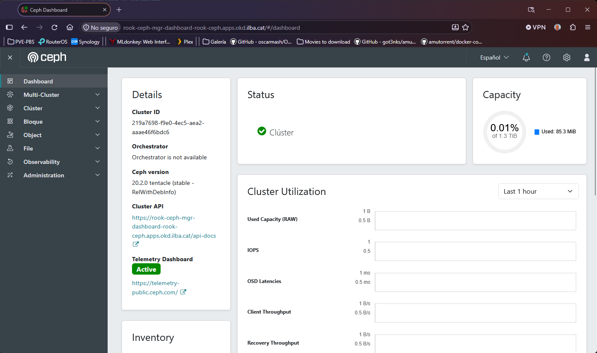
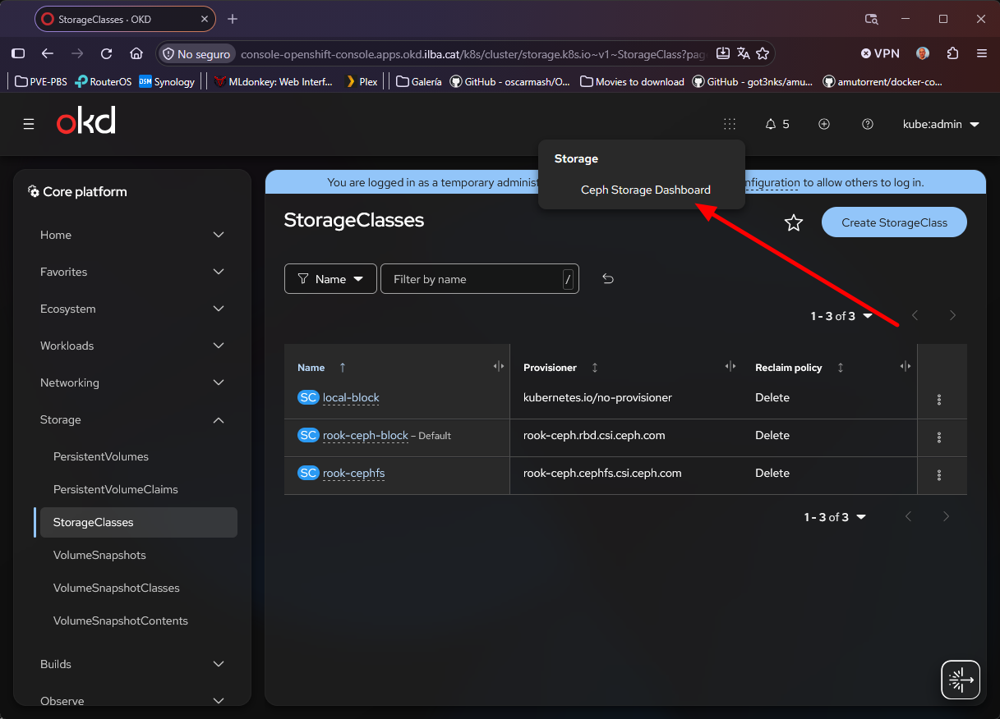

# Verisones

[root@bastion ~]# oc get clusterversion
NAME      VERSION            AVAILABLE   PROGRESSING   SINCE   STATUS
version   5.0.0-okd-scos.6   True        False         19h     Cluster version is 5.0.0-okd-scos.6

[root@bastion ~]# oc get nodes
NAME                 STATUS   ROLES                  AGE   VERSION
infra01.ilba.cat     Ready    infra                  21h   v1.36.5
infra02.ilba.cat     Ready    infra                  21h   v1.36.5
master01.ilba.cat    Ready    control-plane,master   22h   v1.36.5
master02.ilba.cat    Ready    control-plane,master   22h   v1.36.5
master03.ilba.cat    Ready    control-plane,master   22h   v1.36.5
storage01.ilba.cat   Ready    storage                20h   v1.36.5
storage02.ilba.cat   Ready    storage                20h   v1.36.5
storage03.ilba.cat   Ready    storage                20h   v1.36.5
worker01.ilba.cat    Ready    worker                 20h   v1.36.5
worker02.ilba.cat    Ready    worker                 20h   v1.36.5
worker03.ilba.cat    Ready    worker                 20h   v1.36.5
worker04.ilba.cat    Ready    worker                 20h   v1.36.5

host5:~# lsblk
NAME                                  MAJ:MIN RM   SIZE RO TYPE MOUNTPOINTS
sda                                     8:0    0 447.1G  0 disk
sdb                                     8:16   0 447.1G  0 disk
sdc                                     8:32   0 447.1G  0 disk
...

# Proxmox Disk Passthrough

Obtenemos los identificadores únicos de los discos sda, sdb y sdc que están en el equipo de Proxmox:

host5:~# ls -l /dev/disk/by-id/ | grep -E "sd[a-c]$"
lrwxrwxrwx 1 root root  9 Nov 14 08:06 ata-INTEL_SSDSC2KG480G8_PHYG002400TT480BGN -> ../../sdc
lrwxrwxrwx 1 root root  9 Nov 14 08:06 ata-INTEL_SSDSC2KG480G8_PHYG002400UU480BGN -> ../../sdb
lrwxrwxrwx 1 root root  9 Nov 14 08:06 ata-LK0480GFJSK_BTHC719109UM480MGN -> ../../sda
lrwxrwxrwx 1 root root  9 Nov 14 08:06 wwn-0x55cd2e414dc30661 -> ../../sda
lrwxrwxrwx 1 root root  9 Nov 14 08:06 wwn-0x55cd2e415216e03d -> ../../sdc
lrwxrwxrwx 1 root root  9 Nov 14 08:06 wwn-0x55cd2e415216e060 -> ../../sdb

host5:~# qm list | grep -i storage
     20031 storage01.ilba.cat   running    16384            120.00 2301
     20032 storage02.ilba.cat   running    16384            120.00 2384
     20033 storage03.ilba.cat   running    16834            120.00 2484
    
host5:~# qm set 20031 -scsi1 /dev/disk/by-id/ata-LK0480GFJSK_BTHC719109UM480MGN,discard=on,ssd=1,iothread=1
host5:~# qm set 20032 -scsi1 /dev/disk/by-id/ata-INTEL_SSDSC2KG480G8_PHYG002400UU480BGN,discard=on,ssd=1,iothread=1
host5:~# qm set 20033 -scsi1 /dev/disk/by-id/ata-INTEL_SSDSC2KG480G8_PHYG002400TT480BGN,discard=on,ssd=1,iothread=1

[root@bastion ~]# oc debug node/storage01.ilba.cat -- chroot /host lsblk -d -o NAME,SIZE,MODEL,ROTA
NAME   SIZE MODEL         ROTA
sda  447.1G QEMU HARDDISK    0
sr0    876M QEMU DVD-ROM     1
vda    120G                  1

[root@bastion ~]# oc debug node/storage02.ilba.cat -- chroot /host lsblk -d -o NAME,SIZE,MODEL,ROTA
NAME   SIZE MODEL         ROTA
sda  447.1G QEMU HARDDISK    0
sr0    876M QEMU DVD-ROM     1
vda    120G                  1

[root@bastion ~]# oc debug node/storage03.ilba.cat -- chroot /host lsblk -d -o NAME,SIZE,MODEL,ROTA
NAME   SIZE MODEL         ROTA
sda  447.1G QEMU HARDDISK    0
sr0    876M QEMU DVD-ROM     1
vda    120G                  1

# Creación NS

[root@bastion ~]# oc create namespace rook-ceph
[root@bastion ~]# oc adm policy add-scc-to-group privileged system:serviceaccounts:rook-ceph

# Operador rook-ceph

[root@bastion ~]# dnf install -y helm
[root@bastion ~]# helm repo add rook-release https://charts.rook.io/release
[root@bastion ~]# helm repo update

[root@bastion manifests]# mkdir -p ~/manifests/02-rook
[root@bastion manifests]# cd ~/manifests/02-rook

[root@bastion 02-rook]# vim rook-operator-values.yaml
crds:
  enabled: true

nodeSelector:
  node-role.kubernetes.io/storage: ""

tolerations:
  - key: node-role.kubernetes.io/storage
    operator: Exists
    effect: NoSchedule
  - key: node.ocs.openshift.io/storage
    operator: Exists
    effect: NoSchedule

csi:
  enableRbdDriver: true
  enableCephfsDriver: true
  pluginTolerations:
    - key: node-role.kubernetes.io/infra
      operator: Exists
      effect: NoSchedule
    - key: node-role.kubernetes.io/storage
      operator: Exists
      effect: NoSchedule
    - key: node.ocs.openshift.io/storage
      operator: Exists
      effect: NoSchedule
  provisionerNodeAffinity: node-role.kubernetes.io/storage=
  provisionerTolerations:
    - key: node-role.kubernetes.io/storage
      operator: Exists
      effect: NoSchedule
    - key: node.ocs.openshift.io/storage
      operator: Exists
      effect: NoSchedule

hostpathRequiresPrivileged: true

[root@bastion 02-rook]# helm search repo rook-release/rook-ceph
NAME                            CHART VERSION   APP VERSION     DESCRIPTION
rook-release/rook-ceph          v1.21.2         v1.21.2         File, Block, and Object Storage Services for yo...
rook-release/rook-ceph-cluster  1.21.2          v1.21.2         Manages a single Ceph cluster namespace for Rook

helm upgrade --install \
rook-ceph rook-release/rook-ceph \
--namespace rook-ceph \
--version v1.21.2 \
-f rook-operator-values.yaml

[root@bastion 02-rook]# oc get csr -o name | xargs oc adm certificate approve

[root@bastion 02-rook]# helm ls -n rook-ceph
NAME            NAMESPACE       REVISION        UPDATED                                 STATUS          CHART                   APP VERSION
rook-ceph       rook-ceph       1               2026-11-21 09:04:20.64954156 +0100 CET  deployed        rook-ceph-v1.21.2       v1.21.2

[root@bastion 02-rook]# oc -n rook-ceph get pods
NAME                                           READY   STATUS    RESTARTS   AGE
ceph-csi-controller-manager-6dc6ff9685-8c92l   1/1     Running   0          3m11s
rook-ceph-operator-56f9ff5b45-kbkks            1/1     Running   0          3m11s

# Clúster rook-ceph-cluster

[root@bastion 02-rook]# vim rook-cluster-values.yaml
operatorNamespace: rook-ceph

toolbox:
  enabled: true

cephClusterSpec:
  cephVersion:
    image: quay.io/ceph/ceph:v20.2.0
    allowUnsupported: false
  dataDirHostPath: /var/lib/rook
  mon:
    count: 3
    allowMultiplePerNode: false
  mgr:
    count: 2
    allowMultiplePerNode: false
    modules:
      - name: pg_autoscaler
        enabled: true
      - name: prometheus
        enabled: false
  dashboard:
    enabled: true
    ssl: false
  placement:
    all:
      nodeAffinity:
        requiredDuringSchedulingIgnoredDuringExecution:
          nodeSelectorTerms:
            - matchExpressions:
                - key: node-role.kubernetes.io/storage
                  operator: Exists
      tolerations:
        - key: node-role.kubernetes.io/storage
          operator: Exists
          effect: NoSchedule
        - key: node.ocs.openshift.io/storage
          operator: Exists
          effect: NoSchedule
  resources:
    mgr:
      requests:
        cpu: "100m"
        memory: "512Mi"
    mon:
      requests:
        cpu: "100m"
        memory: "512Mi"
    osd:
      requests:
        cpu: "250m"
        memory: "2Gi"
    crashcollector:
      requests:
        cpu: "50m"
        memory: "60Mi"
    exporter:
      requests:
        cpu: "50m"
        memory: "50Mi"
  storage:
    useAllNodes: false
    useAllDevices: false
    nodes:
      - name: "storage01.ilba.cat"
        devices:
          - name: "sda"
      - name: "storage02.ilba.cat"
        devices:
          - name: "sda"
      - name: "storage03.ilba.cat"
        devices:
          - name: "sda"

cephBlockPools:
  - name: ceph-blockpool
    spec:
      failureDomain: host
      replicated:
        size: 3
    storageClass:
      enabled: true
      name: rook-ceph-block
      isDefault: true
      reclaimPolicy: Delete
      allowVolumeExpansion: true
      parameters:
        imageFormat: "2"
        imageFeatures: layering
        csi.storage.k8s.io/provisioner-secret-name: rook-csi-rbd-provisioner
        csi.storage.k8s.io/provisioner-secret-namespace: rook-ceph
        csi.storage.k8s.io/controller-expand-secret-name: rook-csi-rbd-provisioner
        csi.storage.k8s.io/controller-expand-secret-namespace: rook-ceph
        csi.storage.k8s.io/node-stage-secret-name: rook-csi-rbd-node
        csi.storage.k8s.io/node-stage-secret-namespace: rook-ceph
        csi.storage.k8s.io/fstype: ext4

cephFileSystems:
  - name: ceph-filesystem
    spec:
      metadataPool:
        replicated:
          size: 3
      dataPools:
        - failureDomain: host
          replicated:
            size: 3
          name: data0
      metadataServer:
        activeCount: 1
        activeStandby: true
        placement:
          nodeAffinity:
            requiredDuringSchedulingIgnoredDuringExecution:
              nodeSelectorTerms:
                - matchExpressions:
                    - key: node-role.kubernetes.io/storage
                      operator: Exists
          tolerations:
            - key: node-role.kubernetes.io/storage
              operator: Exists
              effect: NoSchedule
            - key: node.ocs.openshift.io/storage
              operator: Exists
              effect: NoSchedule
    storageClass:
      enabled: true
      isDefault: false
      name: rook-cephfs
      pool: data0
      reclaimPolicy: Delete
      allowVolumeExpansion: true
      parameters:
        csi.storage.k8s.io/provisioner-secret-name: rook-csi-cephfs-provisioner
        csi.storage.k8s.io/provisioner-secret-namespace: rook-ceph
        csi.storage.k8s.io/controller-expand-secret-name: rook-csi-cephfs-provisioner
        csi.storage.k8s.io/controller-expand-secret-namespace: rook-ceph
        csi.storage.k8s.io/node-stage-secret-name: rook-csi-cephfs-node
        csi.storage.k8s.io/node-stage-secret-namespace: rook-ceph

cephObjectStores: []

helm upgrade --install \
rook-ceph-cluster rook-release/rook-ceph-cluster \
--namespace rook-ceph \
--version v1.21.2 \
-f rook-cluster-values.yaml

[root@bastion 02-rook]# helm ls -n rook-ceph
NAME                    NAMESPACE       REVISION        UPDATED                                 STATUS          CHART                           APP VERSION
rook-ceph               rook-ceph       1               2026-11-21 09:04:20.64954156 +0100 CET  deployed        rook-ceph-v1.21.2               v1.21.2
rook-ceph-cluster       rook-ceph       1               2026-11-21 09:16:47.888372327 +0100 CET deployed        rook-ceph-cluster-v1.21.2       v1.21.2

[root@bastion 02-rook]# oc -n rook-ceph get pods
NAME                                           READY   STATUS    RESTARTS      AGE
ceph-csi-controller-manager-6dc6ff9685-8c92l   1/1     Running   0             23m
rook-ceph-mon-a-598bd7fbc7-4t6pd               2/2     Running   0             42s
rook-ceph-mon-b-9db6f969-zzb2q                 1/2     Running   1 (13s ago)   6m23s
rook-ceph-mon-c-777bf87777-kzq8k               2/2     Running   0             41s
rook-ceph-operator-7469bc6444-m2mhd            1/1     Running   0             82s
rook-ceph-tools-748887bfd7-m6jkk               1/1     Running   0             18m

[root@bastion 02-rook]# oc -n rook-ceph get cephcluster
NAME        DATADIRHOSTPATH   MONCOUNT   AGE   PHASE   MESSAGE                        HEALTH      EXTERNAL   FSID
rook-ceph   /var/lib/rook     3          20m   Ready   Cluster created successfully   HEALTH_OK              68ab4388-2235-4785-a49f-608749d6707b

[root@bastion 02-rook]# oc -n rook-ceph get pods
NAME                                                           READY   STATUS      RESTARTS        AGE
ceph-csi-controller-manager-6dc6ff9685-8c92l                   1/1     Running     0               26m
rook-ceph-crashcollector-storage01.ilba.cat-77bb4bb86c-vgk5w   1/1     Running     0               21s
rook-ceph-crashcollector-storage02.ilba.cat-7c5bc846fd-9c69f   1/1     Running     0               18s
rook-ceph-crashcollector-storage03.ilba.cat-6d4c97d95-x2g9c    1/1     Running     0               41s
rook-ceph-exporter-storage01.ilba.cat-c9444c85-ndphf           2/2     Running     0               20s
rook-ceph-exporter-storage02.ilba.cat-dbff7d9d-nw4hr           2/2     Running     0               17s
rook-ceph-exporter-storage03.ilba.cat-6948b9b77c-2rfjp         2/2     Running     0               40s
rook-ceph-mds-ceph-filesystem-a-66648f9b9d-rs5ks               2/2     Running     0               21s
rook-ceph-mds-ceph-filesystem-b-569b447b97-wmk6h               2/2     Running     0               18s
rook-ceph-mgr-a-68d5c5dbf9-9dnws                               3/3     Running     0               78s
rook-ceph-mgr-b-5d64878466-54nv8                               3/3     Running     0               77s
rook-ceph-mon-a-598bd7fbc7-4t6pd                               2/2     Running     0               2m52s
rook-ceph-mon-b-9db6f969-zzb2q                                 2/2     Running     1 (2m23s ago)   8m33s
rook-ceph-mon-c-777bf87777-kzq8k                               2/2     Running     1 (2m8s ago)    2m51s
rook-ceph-operator-7469bc6444-m2mhd                            1/1     Running     0               3m32s
rook-ceph-osd-0-78cc8cfbdb-v5nvf                               2/2     Running     0               43s
rook-ceph-osd-1-cd5c97ccc-wfs4j                                2/2     Running     0               43s
rook-ceph-osd-2-64fbfcfc45-shb5w                               2/2     Running     0               41s
rook-ceph-osd-prepare-storage01.ilba.cat-dmzmr                 0/1     Completed   0               54s
rook-ceph-osd-prepare-storage02.ilba.cat-9r4tm                 0/1     Completed   0               53s
rook-ceph-osd-prepare-storage03.ilba.cat-tmvcb                 0/1     Completed   0               52s
rook-ceph-tools-748887bfd7-m6jkk                               1/1     Running     0               20m

[root@bastion ~]# oc get sc
NAME                        PROVISIONER                     RECLAIMPOLICY   VOLUMEBINDINGMODE   ALLOWVOLUMEEXPANSION   AGE
rook-ceph-block (default)   rook-ceph.rbd.csi.ceph.com      Delete          Immediate           true                   50m
rook-cephfs                 rook-ceph.cephfs.csi.ceph.com   Delete          Immediate           true                   50m

# Errores al reiniciar

[root@bastion ~]# oc -n rook-ceph get cephcluster
NAME        DATADIRHOSTPATH   MONCOUNT   AGE   PHASE   MESSAGE                        HEALTH       EXTERNAL   FSID
rook-ceph   /var/lib/rook     3          53m   Ready   Cluster created successfully   HEALTH_ERR              68ab4388-2235-4785-a49f-608749d6707b

[root@bastion ~]# oc -n rook-ceph exec deploy/rook-ceph-tools -- ceph status
[root@bastion ~]# oc -n rook-ceph exec deploy/rook-ceph-tools -- ceph health detail

El problema es este: _Module 'prometheus' has failed: not all arguments converted during string formatting_

[root@bastion ~]# oc -n rook-ceph exec deploy/rook-ceph-tools -- ceph mgr module disable prometheus
[root@bastion ~]# oc -n rook-ceph exec deploy/rook-ceph-tools -- ceph crash archive-all

[root@bastion ~]# oc -n rook-ceph get cephcluster
NAME        DATADIRHOSTPATH   MONCOUNT   AGE   PHASE   MESSAGE                        HEALTH      EXTERNAL   FSID
rook-ceph   /var/lib/rook     3          57m   Ready   Cluster created successfully   HEALTH_OK              68ab4388-2235-4785-a49f-608749d6707b

# Validación

[root@bastion ~]# cd manifests/02-rook/
[root@bastion 02-rook]# vim test-ceph.yaml
apiVersion: v1
kind: PersistentVolumeClaim
metadata:
  name: test-pvc-rbd
  namespace: test-ceph
spec:
  accessModes:
    - ReadWriteOnce
  resources:
    requests:
      storage: 1Gi
  storageClassName: rook-ceph-block
---
apiVersion: v1
kind: PersistentVolumeClaim
metadata:
  name: test-pvc-cephfs
  namespace: test-ceph
spec:
  accessModes:
    - ReadWriteMany
  resources:
    requests:
      storage: 1Gi
  storageClassName: rook-cephfs
---
apiVersion: v1
kind: Pod
metadata:
  name: test-storage-pod
  namespace: test-ceph
spec:
  containers:
    - name: tester
      image: registry.access.redhat.com/ubi9/ubi-minimal:latest
      command: ["/bin/sh", "-c"]
      args:
        - |
          echo "RBD OK - $(date)" > /mnt/rbd/test.txt &&
          echo "CephFS OK - $(date)" > /mnt/cephfs/test.txt &&
          cat /mnt/rbd/test.txt /mnt/cephfs/test.txt &&
          sleep 3600
      volumeMounts:
        - name: vol-rbd
          mountPath: /mnt/rbd
        - name: vol-cephfs
          mountPath: /mnt/cephfs
  volumes:
    - name: vol-rbd
      persistentVolumeClaim:
        claimName: test-pvc-rbd
    - name: vol-cephfs
      persistentVolumeClaim:
        claimName: test-pvc-cephfs

[root@bastion 02-rook]# oc new-project test-ceph
[root@bastion 02-rook]# oc apply -f test-ceph.yaml

[root@bastion 02-rook]# oc get pods
NAME               READY   STATUS    RESTARTS   AGE
test-storage-pod   1/1     Running   0          18s

[root@bastion 02-rook]# oc get pvc
NAME              STATUS   VOLUME                                     CAPACITY   ACCESS MODES   STORAGECLASS      VOLUMEATTRIBUTESCLASS   AGE
test-pvc-cephfs   Bound    pvc-dce02bc2-cbee-45db-8de9-9bc46402fef1   1Gi        RWX            rook-cephfs       <unset>                 105s
test-pvc-rbd      Bound    pvc-4ccc7ce2-6817-40df-ba6d-6da6ca975ee8   1Gi        RWO            rook-ceph-block   <unset>                 105s

[root@bastion 02-rook]# oc exec -it test-storage-pod -- bash

[root@test-storage-pod /]# cat  /mnt/rbd/test.txt
RBD OK - Sat Nov 21 09:48:59 UTC 2026

[root@test-storage-pod /]# cat /mnt/cephfs/test.txt
CephFS OK - Sat Nov 21 09:48:59 UTC 2026

[root@test-storage-pod /]# exit

[root@bastion 02-rook]# oc delete -f test-ceph.yaml
[root@bastion 02-rook]# oc delete project test-ceph

# Errores finales

cat << 'EOF' | oc apply -f -
apiVersion: v1
kind: ServiceAccount
metadata:
  name: rbd-ctrlplugin-sa
  namespace: rook-ceph
---
apiVersion: v1
kind: ServiceAccount
metadata:
  name: rbd-nodeplugin-sa
  namespace: rook-ceph
---
apiVersion: v1
kind: ServiceAccount
metadata:
  name: cephfs-ctrlplugin-sa
  namespace: rook-ceph
---
apiVersion: v1
kind: ServiceAccount
metadata:
  name: cephfs-nodeplugin-sa
  namespace: rook-ceph
---
apiVersion: rbac.authorization.k8s.io/v1
kind: ClusterRole
metadata:
  name: rook-ceph-csi-provisioner-role
rules:
  - apiGroups: [""]
    resources: ["persistentvolumes", "persistentvolumeclaims", "persistentvolumeclaims/status", "events", "secrets", "nodes", "configmaps"]
    verbs: ["get", "list", "watch", "create", "delete", "update", "patch"]
  - apiGroups: ["storage.k8s.io"]
    resources: ["storageclasses", "volumeattachments", "volumeattachments/status", "csinodes"]
    verbs: ["get", "list", "watch", "update", "patch"]
  - apiGroups: ["snapshot.storage.k8s.io"]
    resources: ["volumesnapshots", "volumesnapshotcontents", "volumesnapshotcontents/status", "volumesnapshotclasses"]
    verbs: ["get", "list", "watch", "update", "patch"]
  - apiGroups: ["coordination.k8s.io"]
    resources: ["leases"]
    verbs: ["get", "watch", "list", "delete", "update", "create"]
  - apiGroups: ["csi.ceph.io"]
    resources: ["*"]
    verbs: ["get", "list", "watch"]
---
apiVersion: rbac.authorization.k8s.io/v1
kind: ClusterRoleBinding
metadata:
  name: rook-ceph-csi-provisioner-binding
subjects:
  - kind: ServiceAccount
    name: rbd-ctrlplugin-sa
    namespace: rook-ceph
  - kind: ServiceAccount
    name: rbd-nodeplugin-sa
    namespace: rook-ceph
  - kind: ServiceAccount
    name: cephfs-ctrlplugin-sa
    namespace: rook-ceph
  - kind: ServiceAccount
    name: cephfs-nodeplugin-sa
    namespace: rook-ceph
roleRef:
  kind: ClusterRole
  name: rook-ceph-csi-provisioner-role
  apiGroup: rbac.authorization.k8s.io
EOF

for sa in rbd-ctrlplugin-sa rbd-nodeplugin-sa cephfs-ctrlplugin-sa cephfs-nodeplugin-sa; do
  oc adm policy add-scc-to-user privileged -z "$sa" -n rook-ceph
done

cat << 'EOF' | oc apply -f -
apiVersion: csi.ceph.io/v1
kind: OperatorConfig
metadata:
  name: ceph-csi-operator-config
  namespace: rook-ceph
spec:
  driverSpecDefaults:
    log:
      verbosity: 3
    controllerPlugin:
      deploymentStrategy:
        type: Recreate
    nodePlugin:
      tolerations:
        - key: node-role.kubernetes.io/infra
          operator: Exists
          effect: NoSchedule
        - key: node-role.kubernetes.io/storage
          operator: Exists
          effect: NoSchedule
        - key: node.ocs.openshift.io/storage
          operator: Exists
          effect: NoSchedule
---
apiVersion: csi.ceph.io/v1
kind: Driver
metadata:
  name: rook-ceph.rbd.csi.ceph.com
  namespace: rook-ceph
---
apiVersion: csi.ceph.io/v1
kind: Driver
metadata:
  name: rook-ceph.cephfs.csi.ceph.com
  namespace: rook-ceph
EOF

# Acceso al Dashboard

oc create route edge rook-ceph-mgr-dashboard \
  --service=rook-ceph-mgr-dashboard \
  --port=http-dashboard \
  --insecure-policy=Redirect \
  -n rook-ceph

[root@bastion ~]# oc get secret rook-ceph-dashboard-password -n rook-ceph -o jsonpath='{.data.password}' | base64 -d && echo
F@G0W[Nb0O^`#</.775`

[root@bastion ~]# oc get route -n rook-ceph
NAME                      HOST/PORT                                             PATH   SERVICES                  PORT             TERMINATION     WILDCARD
rook-ceph-mgr-dashboard   rook-ceph-mgr-dashboard-rook-ceph.apps.okd.ilba.cat          rook-ceph-mgr-dashboard   http-dashboard   edge/Redirect   None

# Integración de Dashboard con OKD

[root@bastion 02-rook]# vim ceph-console-link.yaml
apiVersion: console.openshift.io/v1
kind: ConsoleLink
metadata:
  name: ceph-dashboard-link
spec:
  applicationMenu:
    section: Storage
    imageURL: https://rook.io/images/rook-icon.svg
  href: https://rook-ceph-mgr-dashboard-rook-ceph.apps.okd.ilba.cat
  location: ApplicationMenu
  text: Ceph Storage Dashboard

[root@bastion 02-rook]# oc apply -f ceph-console-link.yaml

[root@bastion 02-rook]# oc get consolelink
NAME                  TEXT                     URL                                                           LOCATION          AGE
ceph-dashboard-link   Ceph Storage Dashboard   https://rook-ceph-mgr-dashboard-rook-ceph.apps.okd.ilba.cat   ApplicationMenu   105s

