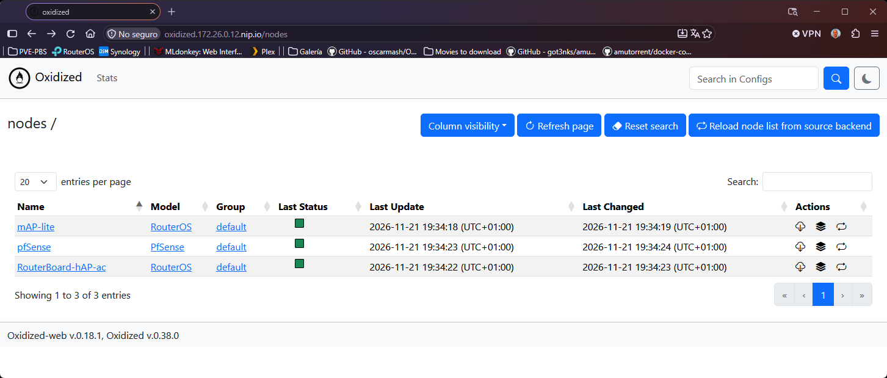
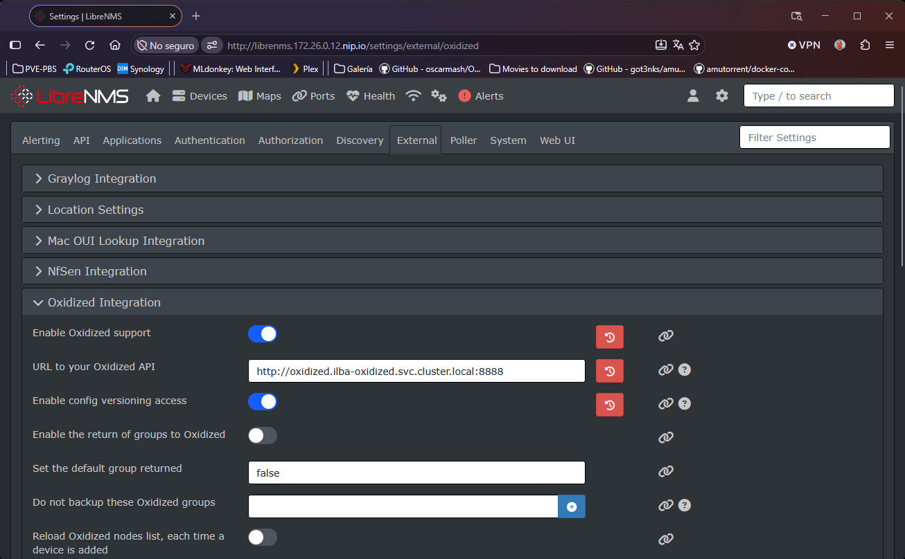
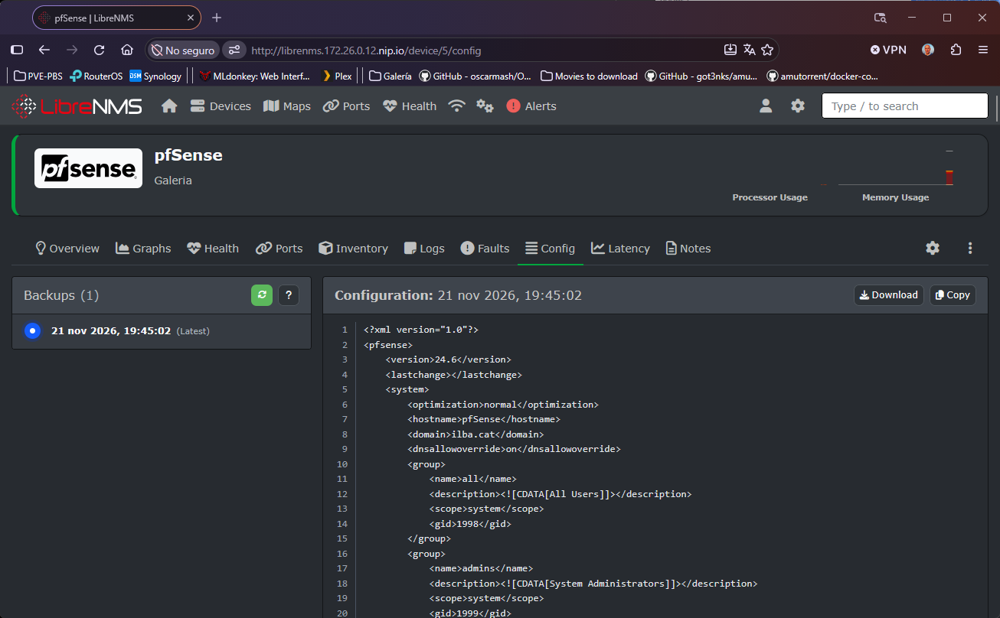

# Instalación de Oxidized

```
oc new-project ilba-oxidized \
--description="Oxidized is a network device configuration backup tool" \
--display-name="Oxidized"
```

```
[root@bastion 52-ilba-oxidized]# vim 01-oxidized-pvc.yaml
apiVersion: v1
kind: PersistentVolumeClaim
metadata:
  name: oxidized-data
  namespace: ilba-oxidized
spec:
  accessModes:
    - ReadWriteOnce
  resources:
    requests:
      storage: 20Gi
```

```
[root@bastion 52-ilba-oxidized]# vim 02-oxidized-config.yaml
apiVersion: v1
kind: Secret
metadata:
  name: oxidized-config
  namespace: ilba-oxidized
type: Opaque
stringData:
  config: |
    ---
    username: default_user_global_ssh
    password: "default_password_global_ssh"
    model: routeros
    resolve_dns: true
    interval: 3600
    use_syslog: false
    debug: false
    threads: 10
    timeout: 20
    retries: 3
    prompt: !ruby/regexp /^([\w.@-]+[#>]\s?)$/
    rest: 0.0.0.0:8888
    next_adds_job: false
    vars: {}
    groups: {}
    pid: "/var/lib/oxidized/pid"
    crash:
      directory: "/var/lib/oxidized/crashes"
      hostnames: false
    input:
      default: ssh
      debug: false
      ssh:
        secure: false
    output:
      default: git
      git:
        user: Oxidized
        email: oxidized@ilba.cat
        repo: "/var/lib/oxidized/oxidized.git"
    source:
      default: csv
      csv:
        file: "/var/lib/oxidized/router.db"
        delimiter: !ruby/regexp /:/
        map:
          name: 0
          ip: 1
          model: 2
          username: 3
          password: 4
        vars_map:
          ssh_port: 5
        gpg: false

  router.db: |
    # Formato: nombre:ip:modelo:usuario:password:puerto_ssh
    172.26.0.9:172.26.0.9:routeros:admin:C@dinor1988:22
    172.26.0.8:172.26.0.8:routeros:admin:C@dinor1988:22
    10.26.0.1:10.26.0.1:pfsense:admin:C@dinor1988:622
```


```
[root@bastion 52-ilba-oxidized]# vim 03-oxidized.yaml
apiVersion: apps/v1
kind: Deployment
metadata:
  name: oxidized
  namespace: ilba-oxidized
spec:
  replicas: 1
  strategy:
    type: Recreate
  selector:
    matchLabels:
      app: oxidized
  template:
    metadata:
      labels:
        app: oxidized
    spec:
      containers:
        - name: oxidized
          image: docker.io/oxidized/oxidized:latest
          command: ["oxidized"]
          env:
            - name: OXIDIZED_HOME
              value: "/var/lib/oxidized"
            - name: HOME
              value: "/var/lib/oxidized"
          ports:
            - name: http
              containerPort: 8888
              protocol: TCP
          volumeMounts:
            - name: data
              mountPath: /var/lib/oxidized
            - name: config
              mountPath: /var/lib/oxidized/config
              subPath: config
              readOnly: true
            - name: config
              mountPath: /var/lib/oxidized/router.db
              subPath: router.db
              readOnly: true
          resources:
            requests:
              cpu: 100m
              memory: 128Mi
            limits:
              cpu: 500m
              memory: 512Mi
      volumes:
        - name: data
          persistentVolumeClaim:
            claimName: oxidized-data
        - name: config
          secret:
            secretName: oxidized-config
---
apiVersion: v1
kind: Service
metadata:
  name: oxidized
  namespace: ilba-oxidized
spec:
  selector:
    app: oxidized
  ports:
    - name: http
      port: 8888
      targetPort: 8888
---
apiVersion: route.openshift.io/v1
kind: Route
metadata:
  name: oxidized
  namespace: ilba-oxidized
spec:
  host: oxidized.172.26.0.12.nip.io
  to:
    kind: Service
    name: oxidized
  port:
    targetPort: http
  tls:
    termination: edge
    insecureEdgeTerminationPolicy: Redirect
```

```
[root@bastion 52-ilba-oxidized]# oc apply -f 01-oxidized-pvc.yaml
[root@bastion 52-ilba-oxidized]# oc apply -f 02-oxidized-config.yaml
[root@bastion 52-ilba-oxidized]# oc apply -f 03-oxidized.yaml
```

```
[root@bastion 52-ilba-oxidized]# oc -n ilba-oxidized get route
NAME       HOST/PORT                     PATH   SERVICES   PORT   TERMINATION     WILDCARD
oxidized   oxidized.172.26.0.12.nip.io          oxidized   http   edge/Redirect   None
```



# Integración con LibreNMS

Verificaremos que el LibreNMS llega al Oxidized (nos ha de devolver un json):

```
[root@bastion 52-ilba-oxidized]# oc exec -n ilba-librenms deploy/librenms-frontend -- curl -s http://oxidized.ilba-oxidized.svc.cluster.local:8888/nodes.json | jq
```

En el engranaje de arriba a la derecha (Global Settings) -> External -> Oxidized Integration



Podremos verificar que ha ido bien:



Para quitar la pestaña Config de los equipos que no están respaldados por Oxidized, se ha de hacer lo siguiente:

* Entramos en la ficha del dispositivo en LibreNMS (por ejemplo, bastion) y pulsamos en el icono de engranaje (Edit).
* Pestaña Misc.
* Cambia el interruptor Exclude from Oxidized? a ON.